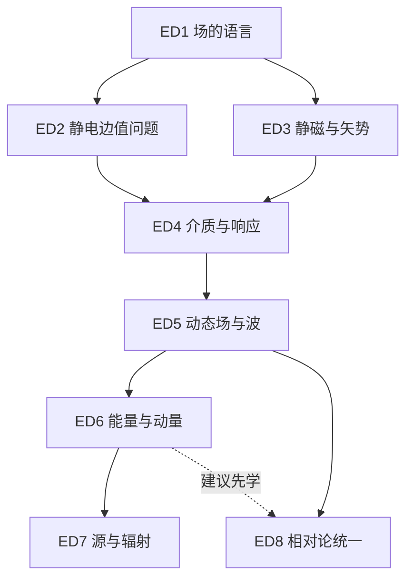

# 电动力学：8 模块课程地图与知识依赖

> 实现更新：2026-10-27。8 模块 / 32 关设计；ED1.1–ED8.4 共三十二关已有交互示范与每关两道示范题，示范覆盖已补齐；模块综合验收未实现。

## 定位与学习起点

面向具有大学基础物理与微积分基础的研究生。目标是重建场、源、边界、守恒与参考系之间的联系；不是完整研究生电动力学教材的替代品。每模块 4 关，采用预测 → 交互 → 解释 → 关键推导 → 迁移的学习循环。

入门物理：认识电荷、电流、库仑力与 Lorentz 力的基本含义；会辨认 E（V/m 或 N/C）、B（T）、φ（V）、ρ（C/m³）、J（A/m²）。数学桥接是自查清单，当前没有桥接测验或学习锁定。

- **B1 微积分与三维矢量**：会偏导、点积 / 叉积、线 / 面 / 体积分；会用柱坐标和球坐标；ED1 内再训练矢量微分。
- **B2 微分方程与边值方法**：会二阶线性 ODE、分离变量、正交展开及 δ 函数；Green 函数在 ED2 内引入。
- **B3 复数、振动与傅里叶**：会复振幅、相位和时间平均；区分 exp[i(k·r−ωt)] 的实部与复表示。
- **B4 线性代数与指标运算**：会矩阵乘法、求和约定与指标升降；Lorentz 变换和四矢量从 ED8.1 开始学习。

## 模块地图与编排理由

以下是本项目的教学编排选择，不是物理定律所规定的唯一顺序。硬先修表示后续关卡默认已掌握的能力，建议先学只用于改善理解；依赖具有传递性。

| 模块 | 核心主题 | 必要先修 | 建议先学 | 可用内容 |
|---|---|---|---|---|
| ED1 | 矢量场、散度、旋度与边界条件 | B1 数学起点 | — | ED1 四关示范；综合验收未完成 |
| ED2 | 静电场、泊松方程与格林函数 | ED1 | — | ED2 四关示范；综合验收未完成 |
| ED3 | 静磁场、矢势与磁场结构 | ED1 | — | ED3 四关示范；综合验收未完成 |
| ED4 | 介质中的电磁场 | ED2 + ED3 | — | ED4 四关示范；综合验收未完成 |
| ED5 | 麦克斯韦方程组与电磁波 | ED4 | — | ED5 四关示范；综合验收未完成 |
| ED6 | 电磁能量、动量与坡印廷矢量 | ED5 | — | ED6 四关示范；综合验收未完成 |
| ED7 | 电磁辐射、偶极辐射与天线 | ED6 | — | ED7 四关示范；综合验收未完成 |
| ED8 | 电动力学的狭义相对论形式 | ED5 | ED6 | ED8 四关示范；综合验收未完成 |

建议顺序：ED1 → ED2 → ED3 → ED4 → ED5 → ED6 → ED7 → ED8。建议顺序不是唯一先修链：ED2 与 ED3 可并行；ED8 可在 ED5 后进入。所有设计均可预览，尚不实施学习锁定。

ED5 整体含介质反射与等离子体色散，因此要求 ED4；真空波子主题可以提前预习。ED1 的界面关卡是静态积分定律训练，ED4 再区分自由源与束缚源，ED5 进一步说明光滑、有限场下的时变界面条件；不能把所有“边界条件”都视为同一层知识。

## 通用验收与状态规则

1. 预测：操作前写出方向或比例；数值题用指定单位和容差进行解析核验。
2. 解释：说清源、场、边界与适用条件；当前阶段采用检查清单自评，不冒充自动语义判题。
3. 推导：补全一个关键步骤，检查符号、单位及至少一个极限。
4. 迁移：改变几何、介质或参考系，说明原结论继续成立或失效的原因。

- 未来模块完成需通过全部四关以及模块综合标准；题目选择正确不能单独代表完整掌握。
- ED1 四关均有参数交互、两道选择题、笔记和 XP；ED1.2 保留 electro 记录键。解释与迁移需自评，模块综合验收仍待开发。
- 原学习记录键 physics-quest-mvp-v1、四关完成度与 XP 计算保持兼容；浏览设计不产生 XP。
- 关卡 ID 使用 ED1.1–ED8.4；ED1.2 对应旧 E1，旧代码课程键仍是 electro。旧 ROADMAP 的 E2–E5 仅作历史草案，不与新模块 ID 混用。
- 关内依赖采用显式关卡 ID：模块内默认承接上一关；模块首关依赖必要先修模块的第 4 关。这是待完整课程实现后的保守学习路径；已有基础者未来可通过诊断测试跳过，当前不设锁。

ED3 / ED4 的实际模型、单位、能量账目、退磁几何与验证边界见 各关模型说明及[物理适用范围](../README.md#物理适用范围)。预设均匀 P/M 的模型不强制线性本构；电容和双介质界面采用标量线性本构。

ED5 / ED6 现有示范的精确模型与边界见 各关模型说明及[物理适用范围](../README.md#物理适用范围)：ED5.3 含正常/斜入射 s/p 与复全反射，左侧仅画入射偏振；ED6.4 两侧均为真空，R/A/T 是预设的被动功率份额，不是材料求解或振幅测量。

ED7 / ED8 已补齐八关，精确模型和验证见 各关模型说明及[物理适用范围](../README.md#物理适用范围)。ED7.2 用完整复场与干涉求能流，ED7.4 区分均匀短元与预设有限线段；ED8 统一度规/boost/指标，并独立核对势求场、源式、四维力和张量变换。

## 八个模块的关卡设计

### ED1 矢量场、散度、旋度与边界条件

**核心问题**：局域的源与环流，如何决定整体通量和边界行为？

**学习产出**：能把场图、积分关系和微分关系互译，并说明从高斯定律求场时为何还需要对称性。

**概念节点**：矢量叠加与通量；散度 / 旋度；Gauss / Stokes 定理；界面法向与切向分量。

**数学起点**：B1。

#### ED1.1 看场，而不只看场线

- 状态：已有交互示范、两道示范题与笔记（完整验收待实现）。
- 先修：B1 数学起点。
- 预测问题：两组电荷的场能否逐分量相加？
- 交互设计：改变源的位置与符号；比较矢量叠加前后。
- 关键推导：由分量叠加计算一个采样点的 E。
- 验收证据：对称中心的 E 抵消；明确场线密度只在约定绘法下示意场强。

#### ED1.2 点电荷与高斯面

- 状态：已有示范（完整验收待实现）。
- 先修：ED1.1。
- 预测问题：球面半径加倍，电场和通量分别怎样变化？
- 交互设计：现有演示：Q（nC）、r（m）；三维球面的二维截面。
- 关键推导：由 Eᵣ·4πr²=Q/ε₀ 得 Eᵣ。
- 验收证据：Eᵣ 变为 1/4，通量不变；Q 反号时二者反号。

#### ED1.3 源与环流：两个积分定理

- 状态：已有交互示范、两道示范题与笔记（完整验收待实现）。
- 先修：ED1.2。
- 预测问题：没有散度的场为什么仍可有旋度？
- 交互设计：比较 F=(ax,ay,az) 与 F=(-ay,ax,0)，a 带相应量纲。
- 关键推导：分别计算散度、旋度，并核对闭合积分。
- 验收证据：第一个场 div F=3a；第二个场 curl F=(0,0,2a)；不把旋度等同于粒子自转。

#### ED1.4 跨过界面：场怎样跳变

- 状态：已有交互示范、两道示范题与笔记（完整验收待实现）。
- 先修：ED1.3。
- 预测问题：为什么薄面两侧的法向场可不连续？
- 交互设计：调整真空面电荷密度 σ 与面电流 K，指定 n 从区域 1 指向 2。
- 关键推导：用薄柱和小矩形推得静态跳跃条件。
- 验收证据：写出 n·(E₂−E₁)=σ/ε₀、n×(B₂−B₁)=μ₀K，并辨认连续分量。

**模块综合验收**：对一个给定场分别算通量和环流；正确选取界面法向；解释一个净通量为零但场非零的反例。

**假设与边界**：先使用静态、分片光滑的场；点源用包围通量解释分布意义。一般时变边界条件留到 ED5。

**误区诊断**：净通量为零不等于处处无场；无旋不自动保证在非单连通区域存在单值全局势。

**天文学迁移**：把天体附近的场结构与观测投影区分开：二维场图不能直接代表三维通量。

### ED2 静电场、泊松方程与格林函数

**核心问题**：给定电荷和边界，电势是否被唯一确定？

**学习产出**：能先判断区域与边界类型，再在镜像法、分离变量和 Green 函数中选择合适工具。

**概念节点**：E=−∇φ；Poisson / Laplace 方程；唯一性与镜像法；多极展开 / Green 函数。

**数学起点**：B2。

- 必要先修 ED1：以梯度、散度、通量和界面条件建立电势边值问题。

#### ED2.1 从电场到电势

- 状态：已有交互示范、两道示范题与笔记（完整验收待实现）。
- 先修：ED1.4。
- 预测问题：为什么静电等势面与电场正交？
- 交互设计：移动点电荷，比较两条积分路径及等势面。
- 关键推导：由 ∇×E=0 在适当区域引入 φ，得 ∇²φ=−ρ/ε₀。
- 验收证据：同端点路径电势差相同；说明单连通条件与 φ 常数自由度。

#### ED2.2 导体与镜像：先满足边界

- 状态：已有交互示范、两道示范题与笔记（完整验收待实现）。
- 先修：ED2.1。
- 预测问题：点电荷靠近接地平面时为什么被吸引？
- 交互设计：改变 q 和距平面高度 a（m），仅显示物理半空间。
- 关键推导：构造镜像 −q 并用唯一性检验 φ=0。
- 验收证据：力指向平面且 ∝a⁻²；不能用 qφ_image 代替相互作用能的 1/2 因子。

#### ED2.3 边值问题的两种语言

- 状态：已有交互示范、两道示范题与笔记（完整验收待实现）。
- 先修：ED2.2。
- 预测问题：同一个 Laplace 方程为何产生不同场？
- 交互设计：调整矩形区域的 Dirichlet 边界，比较分离变量项数。
- 关键推导：分离变量，解释正交模与静电 Green 函数的边界项。
- 验收证据：给出边界残差随截断阶数变化；区别 Dirichlet 与 Neumann 唯一性。

#### ED2.4 多极与格林函数：从源到解

- 状态：已有交互示范、两道示范题与笔记（完整验收待实现）。
- 先修：ED2.3。
- 预测问题：为什么中性源的远场通常更快衰减？
- 交互设计：改变源间距 d 与 r/d，比较精确叠加和偶极近似。
- 关键推导：取 ∇²G=−δ³ 且相同齐次 Dirichlet 边界，写 φ=∫Gρ/ε₀ d³r 加边界项。
- 验收证据：单极势 ∝r⁻¹、偶极势 ∝r⁻²；偶极近似误差在 r≫d 时下降，并解释边界项。

**模块综合验收**：完成接地平面镜像问题并检验边界；区分有净电荷和中性源的远场阶次；说明 Green 函数依赖边界。

**假设与边界**：静电、真空；边界取理想导体。参考电势必须指定；Neumann 问题须满足相容条件且只唯一到常数。

**误区诊断**：镜像电荷是求解指定区域边值问题的数学构造；不能把它当作导体内部真实电荷。

**天文学迁移**：用 r 远大于源尺度的多极展开，判断天体电荷分布的远场主导项；不暗示天体通常带大净电荷。

### ED3 静磁场、矢势与磁场结构

**核心问题**：没有磁荷的场，如何由电流产生并用势描述？

**学习产出**：能用对称性选择 Ampère 或 Biot–Savart 方法，并区分可观测磁场与规范自由度。

**概念节点**：稳恒电流 / 连续性；Ampère 与 Biot–Savart；B=∇×A / 规范；磁偶极矩。

**数学起点**：B1、B2。

- 必要先修 ED1：使用旋度、Stokes 定理和磁场界面条件；无需先完成静电边值模块。

#### ED3.1 稳恒电流与安培环路

- 状态：已有交互示范、两道示范题、反思与导出；模块综合验收未实现。
- 先修：ED1.4。
- 预测问题：何时可把 B 从环路积分中提出？
- 交互设计：改变长直导线电流 I（A）与距离 r（m），再比较非对称环路。
- 关键推导：由 ∮B·dl=μ₀I_enc 推得 B=μ₀I/(2πr)。
- 验收证据：半径加倍 B 减半；解释一般情况下环路积分不能直接决定每点 B。

#### ED3.2 Biot–Savart 与线圈结构

- 状态：已有交互示范、两道示范题、反思与导出；模块综合验收未实现。
- 先修：ED3.1。
- 预测问题：有限线圈为何在远处像磁偶极？
- 交互设计：改变圆线圈半径 R、轴向位置 z 和 I。
- 关键推导：积分得 B_z=μ₀IR²/[2(R²+z²)^(3/2)]。
- 验收证据：z=0 恢复中心场；|z|≫R 时 B∝|z|⁻³。

#### ED3.3 矢势与规范自由度

- 状态：已有交互示范、两道示范题、反思与导出；模块综合验收未实现。
- 先修：ED3.2。
- 预测问题：两个不同的 A 能否产生同一个 B？
- 交互设计：为一个解析 A 添加 ∇χ，比较旋度前后。
- 关键推导：用 ∇×∇χ=0 验证规范不变；说明 Coulomb 规范 ∇·A=0。
- 验收证据：能给出不同 A 对应同一 B 的例子，不将规范选择当作额外物理约束。

#### ED3.4 磁偶极、转矩与能量

- 状态：已有交互示范、两道示范题、反思与导出；模块综合验收未实现。
- 先修：ED3.3。
- 预测问题：磁偶极为什么趋向与外场对齐？
- 交互设计：旋转小电流环与均匀外场 B 的夹角。
- 关键推导：由 m=I S n 推得 τ=m×B、U=−m·B。
- 验收证据：平行取能量极小、反平行取极大；说明偶极近似及外场近似均匀的条件。

**模块综合验收**：复核长直导线和圆线圈轴线场的极限；验证一个规范变换不改变 B；给出磁偶极远场阶次。

**假设与边界**：稳恒电流 ∂ρ/∂t=0、∇·J=0；无限长导线是局部理想化。无磁单极。

**误区诊断**：∇·B=0 不等于 B=0；矢势依赖规范，但磁场不依赖规范。

**天文学迁移**：建立线圈磁场与磁偶极图景，为脉冲星磁场的远区近似做准备；真实磁层不等同于真空偶极。

### ED4 介质中的电磁场

**核心问题**：宏观场方程如何把自由源与物质响应分开？

**学习产出**：能区分 E/B 与 D/H、自由源与束缚源，正确使用本构关系和宏观边界条件。

**概念节点**：P 与束缚电荷；M 与束缚电流；D / H 与自由源；线性本构与边界条件。

**数学起点**：B1。

- 必要先修 ED2：极化、电容和介质界面需要静电势与边值条件。
- 必要先修 ED3：磁化与 H 的定义需要稳恒电流、磁偶极和矢势图景。

#### ED4.1 极化与束缚电荷

- 状态：已有交互示范、两道示范题、反思与导出；模块综合验收未实现。
- 先修：ED2.4、ED3.4。
- 预测问题：整体中性材料为何还能改变电场？
- 交互设计：改变均匀极化 P 与表面法向。
- 关键推导：由偶极密度得 ρ_b=−∇·P、σ_b=P·n。
- 验收证据：均匀 P 的体束缚电荷为零但表面可非零；总电荷守恒。

#### ED4.2 D 场、电容与电源

- 状态：已有交互示范、两道示范题、反思与导出；模块综合验收未实现。
- 先修：ED4.1。
- 预测问题：插入介质后，场与能量一定减小吗？
- 交互设计：分别固定平行板电容器 Q 或 V，改变 ε_r。
- 关键推导：由 D=ε₀E+P 与 C=εA/d 比较 U=Q²/(2C) 和 U=CV²/2。
- 验收证据：同 ε_r 下区分固定 Q / V 的 E、U 变化；固定 V 时计入电源做功。

#### ED4.3 磁化、束缚电流与 H

- 状态：已有交互示范、两道示范题、反思与导出；模块综合验收未实现。
- 先修：ED4.2。
- 预测问题：一个磁化体如何等效为电流？
- 交互设计：改变均匀 M 的方向与界面法向。
- 关键推导：由 J_b=∇×M、K_b=M×n 连接 H=B/μ₀−M。
- 验收证据：均匀 M 的体电流为零但表面电流可非零；不混用自由与总电流。

#### ED4.4 宏观界面与本构边界

- 状态：已有交互示范、两道示范题、反思与导出；模块综合验收未实现。
- 先修：ED4.3。
- 预测问题：介质界面两侧，哪些分量连续？
- 交互设计：改变两侧 ε、μ、σ_free、K_free，固定法向 1→2。
- 关键推导：薄柱 / 环路给出 D 法向、B 法向、E 切向、H 切向的静态跳跃关系。
- 验收证据：无自由面源时正确匹配 D_n、B_n、E_t、H_t；注明光滑有限场与静态假设。

**模块综合验收**：算出一块均匀极化介质的表面束缚电荷；核对自由源边界条件；解释固定 Q 与固定 V 下电容能量的不同变化。

**假设与边界**：基础关卡限静态、均匀、各向同性、线性介质；ε、μ 是宏观响应参数。频散和耗散在 ED5 引入。

**误区诊断**：D 与 H 不等于真空中的 E 与 B；D=εE、B=μH 不是任意介质普遍成立的基本定律。

**天文学迁移**：为星际等离子体的响应建立宏观描述；磁化等离子体一般各向异性，不能套用标量 ε。

### ED5 麦克斯韦方程组与电磁波

**核心问题**：时变场如何满足电荷守恒并以有限速度传播？

**学习产出**：能由 Maxwell 方程推得波动方程，并利用界面条件解释偏振、反射、透射和基本色散。

**概念节点**：Faraday 感应 / 位移电流；波动方程 / 横波；偏振 / 阻抗；Fresnel / 色散 / 截止。

**数学起点**：B2、B3。

- 必要先修 ED4：采用宏观场和本构关系处理介质波及界面；真空波的入门部分可提前预习。

#### ED5.1 感应与位移电流

- 状态：已有交互示范、两道题、反思与导出；解释/迁移需自评，模块综合验收未实现。
- 先修：ED4.4。
- 预测问题：对充电电容器选不同曲面，电流为何一致？
- 交互设计：改变磁通随时间的斜率与电容器充电电流；感应环路固定。
- 关键推导：对 Ampère–Maxwell 方程取散度，恢复 ∂ρ/∂t+∇·J=0。
- 验收证据：用 Faraday 负号判断环流；解释位移电流消除选面矛盾，且不等于电荷穿过真空间隙。

#### ED5.2 由方程到传播

- 状态：已有交互示范、两道题、反思与导出；解释/迁移需自评，模块综合验收未实现。
- 先修：ED5.1。
- 预测问题：没有自由源，场为什么仍能传播？
- 交互设计：改变 k、频率与传播方向，比较 E 和 B。
- 关键推导：用 curl curl 恒等式得 ∇²E−μ₀ε₀∂²_tE=0。
- 验收证据：真空 c=1/√(μ₀ε₀)，B=k×E/ω；E、B、k 两两正交且同相。

#### ED5.3 偏振与界面：匹配场

- 状态：已有交互示范、两道题、反思与导出；解释/迁移需自评，模块综合验收未实现。
- 先修：ED5.2。
- 预测问题：反射振幅的负号意味着什么？
- 交互设计：改变偏振相位差与两侧 ε、μ；从正常入射逐步到斜入射。
- 关键推导：用 E_t、H_t 连续推导正常入射 r=(Z₂−Z₁)/(Z₂+Z₁)、t=1+r，Z=√(μ/ε)。
- 验收证据：Z₁=Z₂ 时 r=0；用实正阻抗核对 |r|²+(Z₁/Z₂)|t|²=1；斜入射区分 s/p。

#### ED5.4 频散、群速度与截止

- 状态：已有交互示范、两道题、反思与导出；解释/迁移需自评，模块综合验收未实现。
- 先修：ED5.3。
- 预测问题：为什么某些射电频率无法在等离子体传播？
- 交互设计：改变电子密度 n_e（m⁻³）与 ω/ω_p，显示实或虚 k。
- 关键推导：线性电子响应得 ω_p²=n_e e²/(m_e ε₀)、ω²=ω_p²+c²k²。
- 验收证据：ω<ω_p 时为倏逝场；ω>ω_p 时 v_g<c，不能把 v_phase 当作信息传播速度。

**模块综合验收**：推得真空波速并检查单位；验证横波关系；由边界求正常入射振幅；区分振幅系数与能流系数。

**假设与边界**：先真空，再无损线性各向同性介质。冷等离子体支线限均匀、无磁场、无碰撞、固定离子背景。采用 exp[i(k·r−ωt)]。

**误区诊断**：电场与磁场的耦合并不意味着真空平面波中二者相差 90°；相速度可超过 c，不代表信号超光速。

**天文学迁移**：用 ω²=ω_p²+c²k² 讨论射电波在理想冷等离子体中的截止；脉冲星色散需群速度与路径积分。

### ED6 电磁能量、动量与坡印廷矢量

**核心问题**：能量和动量究竟如何在场与物质之间转移？

**学习产出**：能为给定控制体写出局域守恒与积分守恒，辨认储能、边界通量及场对物质的做功和力。

**概念节点**：Poynting 定理；储能 / 耗散 / 边界通量；Maxwell 应力张量；辐射压 / 角动量入门。

**数学起点**：B1、B3。

- 必要先修 ED5：能量和动量守恒由时变 Maxwell 方程与 Lorentz 力导出；能流系数用于辐射功率。

#### ED6.1 坡印廷定理：能量账本

- 状态：已有交互示范、两道题、反思与导出；解释/迁移需自评，模块综合验收未实现。
- 先修：ED5.4。
- 预测问题：电阻中的焦耳热从哪里进入？
- 交互设计：改变理想长导线的电流与表面电场，显示表面能流方向。
- 关键推导：将 E·(curl B) 与 B·(curl E) 组合得 ∂_t u+∇·S=−J·E。
- 验收证据：S=E×B/μ₀ 单位 W/m²，J·E 单位 W/m³；解释导线周围的能量流入。

#### ED6.2 储能与输运：选择控制体

- 状态：已有交互示范、两道题、反思与导出；解释/迁移需自评，模块综合验收未实现。
- 先修：ED6.1。
- 预测问题：驻波中为什么储能与平均净输运不同？
- 交互设计：改变两列真空反向波的相位和振幅。
- 关键推导：对周期取平均并积分控制体的能量平衡。
- 验收证据：等幅驻波时间平均净 S 为零而能量非零；不把瞬时 S 当周期平均功率。

#### ED6.3 场动量、应力与辐射压

- 状态：已有交互示范、两道题、反思与导出；解释/迁移需自评，模块综合验收未实现。
- 先修：ED6.2。
- 预测问题：同一入射强度，为何理想反射压力更大？
- 交互设计：改变真空入射强度 I（W/m²）和理想吸收 / 反射边界。
- 关键推导：用 g=S/c² 和应力张量建立动量平衡。
- 验收证据：正常入射理想吸收 p=I/c、镜面反射 p=2I/c；明确压力 N/m² 和反冲方向。

#### ED6.4 用守恒检查一个波实验

- 状态：已有交互示范、两道题、反思与导出；解释/迁移需自评，模块综合验收未实现。
- 先修：ED6.3。
- 预测问题：透射和反射能否只看场振幅？
- 交互设计：比较真空波束入射、反射与吸收功率及控制面法向。
- 关键推导：将能量和动量通量分别在封闭面上积分。
- 验收证据：给出带符号的净功率与净力；核对能量残差，说明介质动量不能直接照搬真空公式。

**模块综合验收**：核对一个控制体的入流、储能变化和 J·E；从能流求辐射压力；正确解释应力积分与场动量变化。

**假设与边界**：能动量主线采用真空微观场。u=(ε₀E²+B²/μ₀)/2、g=S/c² 不直接套用任意介质；频散储能与介质动量划分只作边界说明。

**误区诊断**：局域 S 非零不总意味着存在向无穷远的净辐射；介质中的电磁动量需要同时指定物质贡献与约定。

**天文学迁移**：用入射能流估计理想吸收或反射表面的辐射压，为恒星辐射反馈建立量纲图景。

### ED7 电磁辐射、偶极辐射与天线

**核心问题**：哪些时变场真正把能量送到远方？

**学习产出**：能区分近场、感应场和辐射场，以推迟势、角分布和远区能流解释电偶极辐射及短天线。

**概念节点**：Lorenz 规范 / 推迟势；近区与辐射区；电偶极辐射 / Larmor；短偶极天线 / 波束。

**数学起点**：B2、B3。

- 必要先修 ED6：远区辐射功率必须由能流和守恒判定；同时继承 ED2 的势方法与 ED3 的偶极图景。

#### ED7.1 推迟势与因果传播

- 状态：已有交互示范、两道题、笔记与导出；解释/迁移需自评，模块综合验收未实现。
- 先修：ED6.4。
- 预测问题：远处的场取决于源的现在还是过去？
- 交互设计：改变源到观察点距离 R 和源时序，标出 t_ret=t−R/c。
- 关键推导：在 Lorenz 规范 ∇·A+c⁻²∂_tφ=0 下写势的波动方程与推迟解。
- 验收证据：距离增量 ΔR 导致延迟 ΔR/c；区别 Lorenz 规范与 ED3 的 Coulomb 规范。

#### ED7.2 近场到远场

- 状态：已有交互示范、两道题、笔记与导出；解释/迁移需自评，模块综合验收未实现。
- 先修：ED7.1。
- 预测问题：为什么只有部分场项能在远处保留有限总功率？
- 交互设计：改变 r/λ，分别显示 r⁻³、r⁻²、r⁻¹ 项。
- 关键推导：由辐射场 E,B∝1/r 推出 S∝1/r²。
- 验收证据：远区 ∮⟨S⟩·dA 与半径无关；静态近场不能给出相同远区功率。

#### ED7.3 振荡电偶极与 Larmor 辐射

- 状态：已有交互示范、两道题、笔记与导出；解释/迁移需自评，模块综合验收未实现。
- 先修：ED7.2。
- 预测问题：偶极轴上为何没有电偶极辐射？
- 交互设计：改变 p(t)=p₀ cosωt 的 p₀、ω 与观测角 θ。
- 关键推导：对 sin²θ 角分布积分得 ⟨P⟩=p₀²ω⁴/(12πε₀c³)。
- 验收证据：θ=0 为零、π/2 最强；固定 p₀ 时 ω 加倍功率增 16 倍；非相对论点电荷取 P=q²a²/(6πε₀c³)。

#### ED7.4 短天线与天文迁移

- 状态：已有交互示范、两道题、笔记与导出；解释/迁移需自评，模块综合验收未实现。
- 先修：ED7.3。
- 预测问题：一个接收方向图能否直接等同于天体真实结构？
- 交互设计：调整短偶极长度 ℓ/λ 与取向，比较归一化功率方向图。
- 关键推导：连接局域电流源与偶极矩变化率，并区分场振幅 / 功率方向图。
- 验收证据：在 ℓ≪λ、远场条件下复现 sin²θ；列出长天线、馈电分布和复杂磁层所需的模型升级。

**模块综合验收**：识别 r⁻¹ 辐射项，验证远区总功率对 r 不变；求偶极角分布；解释短天线近似失效条件。

**假设与边界**：真空局域守恒源；ED7.1/ED7.2 用理想点偶极且 R>0，辐射量采用远区 r≫λ 且 r≫源尺度；有限源电偶极近似还需源尺度≪λ。默认非相对论；均匀电流短元 ℓ/λ≤0.05 为教学阈值，超范围不报告其绝对功率。

**误区诊断**：场随时间变化并不足以证明有远区辐射；不能把静态偶极 r⁻³ 场直接拿来算辐射功率。

**天文学迁移**：用偶极方向图理解天线响应；旋转磁偶极仅作脉冲星模型迁移，真实脉冲星磁层和辐射机制更复杂。

### ED8 电动力学的狭义相对论形式

**核心问题**：不同惯性系看到的 E 和 B，如何描述同一个物理过程？

**学习产出**：能固定度规与 boost 约定，用四维电流和场张量写 Maxwell 方程，并用不变量检查变换。

**概念节点**：Lorentz 变换 / 四矢量；四维电流 / 连续性；四势 / 场张量；场不变量 / Lorentz 力。

**数学起点**：B4。

- 必要先修 ED5：协变形式重写的是完整时变 Maxwell 方程；不要求先修辐射模块。
- 建议先学 ED6：场的能量动量与应力有助于理解后续能动张量，但不是本模块四关的必要先修。

#### ED8.1 参考系与四矢量

- 状态：已有交互示范、两道题、笔记与导出；解释/迁移需自评，模块综合验收未实现。
- 先修：ED5.4。
- 预测问题：同时性变化为何也改变电荷密度？
- 交互设计：改变 β=v/c（|β|<1），比较同一组事件的坐标。
- 关键推导：写 x′=γ(x−vt)、t′=γ(t−vx/c²)，保持时空间隔。
- 验收证据：β→0 恢复低速极限；不能把不同参考系的同时截面当作同一组空间事件。

#### ED8.2 四维电流与连续性

- 状态：已有交互示范、两道题、笔记与导出；解释/迁移需自评，模块综合验收未实现。
- 先修：ED8.1。
- 预测问题：一个系中的电荷密度如何与电流混合？
- 交互设计：选择沿 x 的 boost，改变 ρ、J_x、β。
- 关键推导：由 J^μ 变换得 ρ′=γ(ρ−vJ_x/c²)，并写 ∂_μJ^μ=0。
- 验收证据：在 J_x=0 的例子核对密度增加与电流方向；说明总电荷守恒和局域密度的区别。

#### ED8.3 四势与场张量

- 状态：已有交互示范、两道题、笔记与导出；解释/迁移需自评，模块综合验收未实现。
- 先修：ED8.2。
- 预测问题：四条 Maxwell 方程如何写成协变方程？
- 交互设计：查看 F 张量各分量与 E/B 的对应，切换指标升降。
- 关键推导：定义 F^μν=∂^μA^ν−∂^νA^μ；展开 Maxwell 方程，并连接四维力 f^μ=qF^μνU_ν。
- 验收证据：使用 F^0i=−E_i/c、F^ij=−ε_ijkB_k，复原 ∂_μF^μν=μ₀J^ν 的 Gauss 和 Ampère–Maxwell 分量。

#### ED8.4 场变换与不变量

- 状态：已有交互示范、两道题、笔记与导出；解释/迁移需自评，模块综合验收未实现。
- 先修：ED8.3。
- 预测问题：能否找到让磁场完全消失的惯性系？
- 交互设计：改变 boost 方向与大小，对比 E′、B′ 及两个不变量。
- 关键推导：用 E′_⊥=γ(E+v×B)_⊥、B′_⊥=γ(B−v×E/c²)_⊥，平行分量不变。
- 验收证据：核对 E·B、E²−c²B²；纯电系要求 E·B=0 且 E²−c²B²>0；非零平面电磁波的两个不变量均为零，不能变为纯电或纯磁场。

**模块综合验收**：对一个明确 boost 算 E′、B′；验证 E·B 和 E²−c²B² 不变；用分量复原 Maxwell 方程的符号。

**假设与边界**：惯性系、SI；x^μ=(ct,x,y,z)，η=diag(+1,−1,−1,−1)，J^μ=(cρ,J)，A^μ=(φ/c,A)。S′ 相对 S 以 +v 运动。

**误区诊断**：电场与磁场分量依赖参考系，电荷守恒与场不变量不依赖；纯电或纯磁参考系并非总存在。

**天文学迁移**：为相对论喷流和辐射问题建立变换基础；多普勒增亮与同步辐射谱须另加辐射模型。

## 单位、符号与实现约束

- 统一采用 SI：D（C/m²）、H / M（A/m）、P（C/m²）、A 矢势（T·m）、S（W/m²）、u（J/m³）。电势 φ 与通量 Φ 分开命名。
- 静态真空界面法向 n 由区域 1 指向区域 2：n·(E₂−E₁)=σ/ε₀、n×(B₂−B₁)=μ₀K，E 切向与 B 法向连续。介质中用自由 σ、K 匹配 D、H。极化体公式中的 n 则是材料外法向。
- 电磁波复表示 exp[i(k·r−ωt)]，图形显示实部；振幅、瞬时量与周期平均量分开标注。基础反射系数限实正阻抗的无损传播介质，倏逝 / 吸收场需另算。
- 静电 Green 函数使用 ∇²G=−δ³ 的归一化；自由空间 G=1/(4πR)，非零边界势必须保留边界贡献。静电边值 Green 函数与 ED7 的推迟 Green 函数区分。
- 相对论 x^μ=(ct,x,y,z)，η=diag(+1,−1,−1,−1)，A^μ=(φ/c,A)，J^μ=(cρ,J)，F^μν=∂^μA^ν−∂^νA^μ。F^0i=−E_i/c，F^ij=−ε_ijk B_k，∂_μF^μν=μ₀J^ν；齐次方程写为 ∂_λF_μν+∂_μF_νλ+∂_νF_λμ=0。
- boost 约定：S′ 相对 S 以 +v 运动；平行分量不变，垂直分量按课程数据中的式子变换。每个数值题必须检查 β→0、量纲与两个场不变量。
- 新模拟实现时先建立解析基准、极限和守恒检查；数值网格收敛与模型误差单独记录，不能把画图误差当成物理现象。
- 不接入新后端、AI 服务或外部模拟代码；资源仅提供官方链接。

## 后续实施顺序

1. ED1.1–ED8.4 共三十二关交互示范已实现。后续补解释/迁移自评与综合验收，形成有明确掌握标准的模块。
2. 持续核验全部示范的物理边界；增加跨模块的数值预测、解释与迁移题。
3. ED7/ED8 已开放；继续增加真实浏览器、窄屏和实体设备验证，保留 ED8 不依赖 ED7 的先修分支。
4. 把桥接自测、模块综合挑战与复习机制接入课程状态，再实施基于掌握证据的解锁。

## 资料依据

检索与核对日期：2026-10-26。引用用于核对主题覆盖，32 关的交互和依赖设计为本项目原创编排。

- [MIT OCW · 8.07 讲义目录](https://ocw.mit.edu/courses/8-07-electromagnetism-ii-fall-2012/pages/lecture-notes/)：核对矢量分析、边值问题、磁多极、介质、波、势和辐射的覆盖范围。
- [David Tong · Electromagnetism](https://davidtong.org/teaching/electromagnetism/)：核对静电、静磁、动态场、相对论、辐射与介质的主题范围。

## 课程地图初次实现与验证（历史）

- 网页入口：打开 index.html 后选择“电动力学”。离线本地脚本支持课程地图，无新增运行依赖。
- 课程数据：electrodynamics-curriculum.js；界面：course-map.js、course-map.css；本文件据课程数据同步生成。
- 自动检查：node tests/test_curriculum.js 验证 8 模块 / 32 关、引用完整性、两种依赖无环、建议顺序、并行分支和旧关卡映射；node tests/test_physics.js 复核原有 12 项解析模型检查。
- 课程设计通过结构与公式复核，不等于其余 24 个计划模拟已实现或经过教学有效性验证。

- 浏览器验证：桌面内置浏览器已检查全部 8 模块切换、ED8.1 → ED5.4 先修跳转和高斯面示范入口；浏览设计后进度仍为 0/4、0 XP。未测试移动端、其他浏览器或浏览器重启后的持久化。

## ED1 示范实现补充（2026-10-27）

- 数据与页面：ed1-lessons.js、ed1-renderer.js，复用 app.js；四关使用独立记录，ED1.2 保留旧 electro。入口页面用内容哈希版本号加载全部资源。
- ED1.3 以速度场单位演示：F 为 m/s，a 为 s⁻¹；闭合积分对球面，环流对 xy 圆周，不能把环流场当作静电场。
- ED1.4 固定 z=0、n=+z、K=Kₓx̂，故 ΔBᵧ=−μ₀Kₓ；统一背景场仅改变连续分量。
- 检查命令：node tests/test_ed1.js（独立积分/差分/符号检查）、node tests/test_ed1_app.js（无浏览器的接线与记录检查）。测试断言与容差见对应测试源码；模拟页面检查不能替代真实浏览器验收。
- 本轮未进行真实浏览器验收；上方 2026-10-26 的浏览器验证属于历史记录，不适用于本轮新示范的真实显示。

参考：[MIT 矢量积分定理](https://web.mit.edu/wwmath/vectorc/ispath/unit8.html)、[Feynman：高斯定律应用](https://www.feynmanlectures.caltech.edu/II_05.html)、[University of Virginia：磁场边界条件](https://galileoandeinstein.phys.virginia.edu/Elec_Mag/2022_Lectures/EM_34_Magnetostatic_Bdry_Conds.html)。

## ED2 示范实现补充（2026-10-27）

- 四关复用共享导航、判题、笔记及导出，新增稳定记录键 ED2.1–ED2.4。全站 11 关、22 题，最高 1100 XP；ED1.2 的 electro 键保持兼容。
- ED2.1：真空点电荷势 φ=kq/R+C；从 A=(−1,0,1) m 到 B=(1,0,1) m，直线和折线各段采用 120 等分 Simpson 积分。端点差与积分独立计算；C 不改变 E 与 Δφ。
- ED2.2：接地导体 z≤0，只在 z≥0 求真空侧值。真实电荷位于 z=a；φ=kq(1/R₊−1/R₋)，Fz=−kq²/(4a²)，U=−kq²/(4a)，排除自能。镜像不是内部真实点源。
- ED2.3：沿 z 平移不变的矩形 L=2 m、H=1.5 m。左右及底边为零势，顶边为正弦或连续三角形受控势分布（非整块等势导体）；显示最高谐波 N≤20 的 φN、场分量及 400 个顶边中点上的 RMS/max 残差。无源不等于无场；二维模型须使用相应二维 Green 核。
- ED2.4：自由偶极、同号双源及接地半空间三种模式，比较精确势与首个非零多极项。势的单极 / 偶极阶次为 r⁻¹ / r⁻²；零势方向和 q=0 时相对误差无定义。接地核满足 ∇′²GD=−δ³ 和齐次 Dirichlet 条件；一般非零边界还需 −∮f∂n′GD。
- 点源周 0.08 m 遮罩，缺失不当零；物理量采用 SI，输入电荷 nC；图示明确几何截面、坐标、单位和箭头尺度，无平滑或随机过程。
- 检查：test_ed2.js 覆盖数值积分、梯度、镜像边界/力/能量/诱导总电荷、Laplace 残差、模系数独立投影、多极极限、零势与非法输入。test_ed2_app.js 穷举控件端点/默认值组合并验证判题、旧记录、笔记导出及模拟重载。
- 后台内置预览已查看四个默认页面，并操作接地模式和 θ=90°；未启动 Safari，未访问用户原端口的学习存储。移动端与 Safari 的实际显示、真实重启持久化仍未复验。

核对资料：[Feynman：静电势、偶极与镜像法](https://www.feynmanlectures.caltech.edu/II_06.html)、[MIT：Electromagnetics 课程讲义，第 4 章](https://live.ocw.mit.edu/courses/6-013-electromagnetics-and-applications-spring-2009/d3be4ea78b036a6362230fb41780cf54_MIT6_013S09_notes.pdf)、[Jackson：Introduction to Electrostatics，第 1 章](https://catalogimages.wiley.com/images/db/pdf/9780471309321.excerpt.pdf)。
