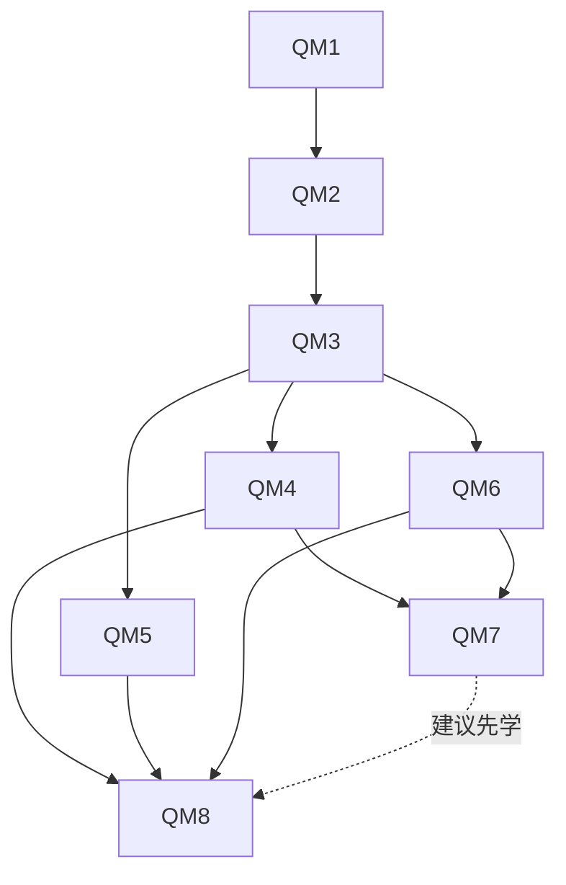

# 量子力学：8模块／32关课程地图与知识依赖

> 更新：2026-10-28（Asia/Shanghai）。QM1～QM8共32关已有交互示范，均含故事、问题导入及两道示范题。全站66关／132题／最高6600 XP；QM1.1沿用旧quantum记录，123项中英词表保留。示范覆盖完成不等于完整模块掌握，模块综合验收尚未实现。

## 定位、教材分工与核查边界

面向具有大学物理、微积分及基础线性代数知识的研究生，用交互导学重建量子力学概念与推导。此32关骨架不替代完整研究生课程。基础层采用“物理问题 → 列式理由 → 关键一步 → 极限检验”，进阶层要求独立推导、说明边界与近似，并用极限或独立方法复核。当前32关均已提供基础正文、交互示范、两道自动判题与进阶自评；模块综合验收仍待开发。

- [Susskind · The Theoretical Minimum：量子力学（2012年冬季）](https://theoreticalminimum.com/courses/quantum-mechanics/2012/winter)：已核查该课程公开的10讲标题及简介；用于态、算符、演化、纠缠与傅里叶的概念导入，不宣称覆盖本地图全部原子及近似方法，也未逐段观看视频。
- [Griffiths与Schroeter · Introduction to Quantum Mechanics，第3版（2018）](https://assets.cambridge.org/97811071/89638/toc/9781107189638_toc.pdf)：已核查出版社第三版目录，逐模块列出章节定位；不混用第二版章节，不声称逐页核对正文。
- [Sakurai与Napolitano · Modern Quantum Mechanics，第3版](https://www.cambridge.org/highereducation/books/modern-quantum-mechanics/DF43277E8AEDF83CC12EA62887C277DC)：作为后续研究生进阶阅读。出版社介绍确认其研究生教材定位；本轮不提供未经核查的页码，不以本地图替代完整研究生课程。

教材分工是本项目的编排建议，非原作者采用相同路线的声明。本项目采用 David J. Griffiths 与 Darrell F. Schroeter 合著的2018年第三版。The Theoretical Minimum采用可核查的2012年冬季课程，不将其他年份的讲次混用。

## 总览与依赖

| 模块 | 内容 | 必要先修 | 建议先学 | 实现状态 |
|---|---|---|---|---|
| QM1 | 波函数、复振幅与概率解释 | 数学起点 | — | 四关交互示范已实现 |
| QM2 | 希尔伯特空间、算符、测量与复合态 | QM1 | — | 四关交互示范已实现 |
| QM3 | 薛定谔方程、幺正演化与守恒 | QM2 | — | 四关交互示范已实现 |
| QM4 | 一维束缚态、势垒与散射 | QM3 | — | 四关交互示范已实现 |
| QM5 | 谐振子、升降算符与相干态 | QM3 | — | 四关交互示范已实现 |
| QM6 | 角动量、自旋、旋转与耦合 | QM3 | — | 四关交互示范已实现 |
| QM7 | 中心势、氢原子与全同粒子 | QM4 + QM6 | — | 四关交互示范已实现 |
| QM8 | 近似方法、含时微扰与跃迁 | QM4 + QM5 + QM6 | QM7 | 四关交互示范已实现 |

建议顺序：QM1 → QM2 → QM3 → QM4 → QM5 → QM6 → QM7 → QM8。QM3之后，QM4、QM5、QM6可以分支学习；QM7需要QM4与QM6，QM8需要QM4、QM5、QM6，建议先看QM7原子应用。所有设计开放浏览，无学习锁定；先修不是用户已掌握的证据。

模块依赖图表达主题联系；关卡元数据使用具体先修ID。跨模块只要求必要小节，不机械绑定先修模块第4关，也不因编号大小推断依赖。数学起点可供自检，当前不设诊断测试或学习锁。

## 数学起点

- **QB1 复数与概率**：会模方、复共轭、相位、条件概率与归一化；区分密度和区间概率。
- **QB2 微积分与微分方程**：会积分、分部积分、二阶线性方程及边界条件；先检查函数和导数是否在适用域。
- **QB3 振动与傅里叶**：会角频率、叠加与傅里叶变换；统一正负号、2π及归一化，标准差不混作半高全宽。
- **QB4 线性代数**：会复内积、共轭转置、厄米/酉矩阵、本征问题与张量积；偏迹在QM2.4内引入。
- **QB5 球坐标与渐近估计**：会球坐标体积元、角积分、泰勒展开和无量纲小参数；特殊函数与转折点方法在相关模块内补充。

## 验收、记录与显示约定

1. 预测：操作前说明会变的是振幅、相位、概率、期望值还是能量，写出定量比例或可证伪的判断。
2. 解释：区分态、测量、时间演化与显示缩放；明确边界条件、算符适用域、单位及模型近似。
3. 推导：独立补全关键步骤，检查归一化或概率流、量纲与极限；近似方法给出小参数和误差。
4. 迁移：更换初态、测量基、势或外场后重新检查结论；解释与迁移为设计验收，当前不自动计分。

非相对论量子力学；ℏ保留显式，内部SI，nm/eV/fs等显示单位须注明换算。概率无量纲，一维ψ单位m⁻¹ᐟ²、密度m⁻¹；无量纲横坐标须连同雅可比。相位默认rad，时间因子e⁻ⁱᴱᵗᐟℏ，p=−iℏ∂x。图示、解析态、数值截断和真实测量分别标注；数值方法含确定性求积、求根、复振幅匹配、有限矩阵对角化与完整余弦驱动的四阶龙格—库塔积分；无随机取样。原始密度保留，分箱明确标出箱宽。

- 原学习键 physics-quest-mvp-v1、主题键 physics-quest-theme-v1及 quantum 记录保持；QM1.1仅作地图ID，指向同一个旧关卡，不复制或新增答题记录。
- 可运行总量为66关／132题／最高6600 XP；量子32关，不额外复制QM1.1记录。浏览、调参及切换标签不创建完成状态。
- QM1.1保留n/L与原两题，增800段辛普森归一化积分、ψ的SI单位与密度nm⁻¹；图为√Lψ、L|ψ|²，积分显式含雅可比。
- 高斯画窗为均值±3σ并列遗漏概率；有限阱全实轴归一化、两侧各画3个衰减长度并列遗漏概率。矩阵图3位有效数字且|值|<10⁻¹²显示0，数值表保留更高精度；未平滑、卷积或随机取样。
- 简并测量使用吕德斯子空间投影，精确角度端点按数学极限处理；p=0时条件态显示未定义，小而非零的概率保留。两态演化是预设恒定哈密顿量的精确解，不含耗散。
- 势阶与势垒均以通量定义R/T；阈值单独取极限。势垒宽度控件d=a/ℓ≤12，保留稳定ln T与三段绝对通量残差。极小T的净流受反射区浮点消减影响；不宣称任意厚势垒或波包传播求解。
- 量子课程现提供课程地图／交互示范／核心概念中英对照三个标签。词表按QM1–QM8切换；标签往返保留当前参数和待保存笔记，查词不写学习记录。电动力学原词表与三标签保留。

## 八个模块的关卡设计

### QM1 波函数、复振幅与概率解释

**核心问题**：波函数怎样给出可测概率，边界又为何筛选出能级？

**学习产出**：能区分振幅、概率密度和区间概率，检查归一化，并用相位与傅里叶宽度解释干涉及不确定性。

**概念节点**：玻恩概率解释；归一化与边界；整体相位 / 相对相位；傅里叶与标准差。

**数学起点**：QB1、QB2、QB3。

**必要先修**：无其他模块。

**模型边界**：先用一维非相对论单粒子；位置取实数轴或指定势阱区间。连续位置本征态不是可归一化粒子态；无随机取样。

**易混点**：ψ 可为复数或负数；|ψ|² 是密度，不是某一点的有限概率。概率云不是粒子经典轨道。

**模块掌握标准（待实现）**：独立归一化一个态、计算区间概率，说明整体相位为何不改概率；用定义一致的标准差核对高斯波包下界。

**天文学迁移**：为原子轨道概率及谱线能级建立语言；无限方阱不是氢原子，空间概率密度不直接等于观测亮度。

**阅读定位**：[Griffiths与Schroeter · Introduction to Quantum Mechanics，第3版（2018）](https://assets.cambridge.org/97811071/89638/toc/9781107189638_toc.pdf)：§1.2–1.6、§2.2、§3.5.2；[Susskind · The Theoretical Minimum：量子力学（2012年冬季）](https://theoreticalminimum.com/courses/quantum-mechanics/2012/winter)：2012年课程第8–10讲：一维粒子、傅里叶与不确定性。

#### QM1.1 无限深势阱：边界与归一化

- 状态：沿用原有 n/L 势阱示范、两道题、笔记与 quantum 记录。已补归一化数值积分、雅可比与物理单位对照；示范题完成不等于模块掌握。
- 必要先修：本模块数学起点
- 核心问题：为什么只有某些驻波能留在势阱里？
- 交互设计：现有 n=1–5、L=0.5–3 nm 控件显示节点和能量；并显示归一化积分与物理单位对照。
- 关键推导：ψ(0)=ψ(L)=0 给 k=nπ/L；∫₀ᴸ|ψ|²dx=1 给 ψₙ=√(2/L)sin(nπx/L)，Eₙ=n²π²ℏ²/(2mL²)。
- 验收证据：保留已有节点与 L⁻² 两题；并检验归一化、ψ 的长度负二分之一次方量纲，现已提供数值与单位核验。
- 模型与单位：阱内 V=0、阱外无穷高，m 为电子质量；图示分别为√Lψ和L|ψ|²；概率积分使用雅可比L。
- 实现约定：单电子，0<x<L，阱内V=0、阱外无穷高。横轴ξ=x/L；绿线√Lψ无量纲、紫线L|ψ|²无量纲，两者有不同物理意义。表列ψ的SI单位m⁻¹ᐟ²与密度nm⁻¹；归一化用800段辛普森求积，不把独立缩放曲线的视觉面积当概率。
- 进阶任务（自评，不自动计分）：从边界排除 n=0，并检验不同 n 的正交性；解释改变能量零点不改变能级差。

#### QM1.2 从密度到区间概率

- 状态：已实现参数交互、图示与核验、两道示范题及进阶自评；示范题完成不等于模块掌握。
- 必要先修：QM1.1
- 核心问题：概率密度的峰值能大于1吗？
- 交互设计：交互：在阱内移动区间端点 a/L、b/L，比较密度曲线、高亮面积与解析概率。
- 关键推导：P(a≤x≤b)=∫ₐᵇ|ψ|²dx；令 ξ=x/L，概率积分改为 ∫L|ψ(Lξ)|²dξ。
- 验收证据：全区间概率为1、零宽区间为0；对连续分布单点概率为0。移动区间后仍须满足0≤P≤1。
- 模型与单位：位置分布连续，0≤a≤b≤L；密度以 nm⁻¹ 或 m⁻¹显示，横坐标和积分必须采用同一单位。
- 实现约定：同一无限深势阱；曲线是L|ψ|²，积分横轴ξ=x/L，面积才等于概率。两个端点自动按小到大排列，实际区间在表中明确列出；密度nm⁻¹另列。解析值与800段独立求积对照。无随机取样。
- 进阶任务（自评，不自动计分）：推导方阱区间概率的闭式表达式，再用独立求积核对；讨论区间穿过节点时概率如何变化。

#### QM1.3 叠加、相对相位与干涉

- 状态：已实现参数交互、图示与核验、两道示范题及进阶自评；示范题完成不等于模块掌握。
- 必要先修：QM1.2
- 核心问题：相同的能量占据概率能对应不同的位置分布吗？
- 交互设计：交互：ψ=cosθ ψ₁+eⁱᵟ sinθ ψ₂，调 θ、δ 和整体相位 χ；比较相干叠加与去掉交叉项的混合。
- 关键推导：|ψ|²=cos²θ|ψ₁|²+sin²θ|ψ₂|²+2cosθ sinθ Re(eⁱᵟψ₁*ψ₂)；正交性使总范数为1。
- 验收证据：整体相位不改密度，相对相位改变交叉项；能量测量概率仍为 cos²θ、sin²θ。
- 模型与单位：固定时刻的两定态叠加，不声称自动演化；相位用 rad，θ∈[0,π/2]。纯态与混合态的正式定义见QM2.4。
- 实现约定：固定时刻，ψ=cosθψ₁+exp(iδ)sinθψ₂，再乘exp(iχ)。ξ=x/L，曲线为L|ψ|²。基矢正交，整体相位与相对相位分别控制；本页不自动演化。混合曲线只删除交叉项，不是一个新的纯态。
- 进阶任务（自评，不自动计分）：构造同一能量占据但不同位置分布的反例，解释为什么只知道 |cₙ|² 不足以确定纯态。

#### QM1.4 高斯波包与不确定性

- 状态：已实现参数交互、图示与核验、两道示范题及进阶自评；示范题完成不等于模块掌握。
- 必要先修：QM1.3
- 核心问题：把波包压窄，究竟哪种宽度必须增大？
- 交互设计：交互：调整 σₓ、x₀、p₀，画位置与动量密度；分别显示标准差和数值显示窗口遗漏概率。
- 关键推导：ψ∝exp[−(x−x₀)²/(4σₓ²)+ip₀x/ℏ]；取 φ(p)=(2πℏ)⁻¹ᐟ²∫e⁻ⁱᵖˣᐟℏψ(x)dx，得 σₚ=ℏ/(2σₓ)。
- 验收证据：σₓσₚ=ℏ/2；改 p₀ 只平移动量均值。不得把半高全宽、标准差或绘图截断混作同一宽度。
- 模型与单位：实数轴最小不确定高斯纯态，σₓ>0；横轴 nm、动量可用 ℏ/nm，计算统一SI。有限画布不重新归一化真实态。
- 实现约定：实数轴最小不确定高斯纯态，无二次相位。φ(p)=(2πℏ)⁻¹ᐟ²∫exp(−ipx/ℏ)ψdx。左横轴x[nm]密度nm⁻¹，右横轴k=p/ℏ[nm⁻¹]密度nm；分别显示均值±3σ窗口和遗漏概率，绝不按画布重新归一化。
- 进阶任务（自评，不自动计分）：独立傅里叶变换并检查普朗歇尔关系；说明带二次相位的高斯态为何一般不再饱和简单乘积下界。

### QM2 希尔伯特空间、算符、测量与复合态

**核心问题**：同一个态为何在不同测量基下给出不同概率？

**学习产出**：能使用内积、厄米算符和谱投影计算测量概率，区分纯态、混合态与纠缠。

**概念节点**：态矢 / 内积 / 基变换；厄米算符 / 谱投影；对易关系 / 不确定性；张量积 / 约化态。

**数学起点**：QB1、QB4。

**必要先修**：QM1：使用归一化、复振幅和叠加概率；QM1的波动力学图景连接抽象态空间。。

**模型边界**：交互设计优先使用有限维矩阵；位置与动量的无界算符须额外指定定义域，不能仅凭形式厄米性断言自伴。

**易混点**：基变换不等于对系统施加物理旋转；非选择测量后的混合态不等于每次都得到某个固定纯态。

**模块掌握标准（待实现）**：给定2×2厄米矩阵和归一化态，算本征值、投影概率及测后态；对一个两比特态做偏迹并验证局域统计。

**天文学迁移**：为自旋与偏振态的矩阵描述准备工具；经典偏振类比不能独立证明量子纠缠。

**阅读定位**：[Griffiths与Schroeter · Introduction to Quantum Mechanics，第3版（2018）](https://assets.cambridge.org/97811071/89638/toc/9781107189638_toc.pdf)：第3章、§12.1–12.3；[Susskind · The Theoretical Minimum：量子力学（2012年冬季）](https://theoreticalminimum.com/courses/quantum-mechanics/2012/winter)：2012年课程第1–3讲及第6–8讲：态、算符、纠缠。

#### QM2.1 态矢、内积与基变换

- 状态：已实现参数交互、图示与核验、两道示范题及进阶自评；示范题完成不等于模块掌握。
- 必要先修：QM1.3、QM1.4
- 核心问题：换一组坐标，会不会改变物理态？
- 交互设计：交互：调整归一化复二维态与基底酉矩阵 U，比较态坐标和同一物理测量的概率。
- 关键推导：新基列向量组成U时 c′=U†c、A′=U†AU；⟨A⟩=c†Ac=c′†A′c′。
- 验收证据：范数与期望值不变；必须同时变换态和算符。主动旋转仅改态时可改变固定仪器的测量概率。
- 模型与单位：正交归一基，U†U=I；复向量概率无量纲，抽象两态不预先解释为真实空间方向。
- 实现约定：正交归一复二维态，U的列为新基；U=[[cosβ,−e⁻ⁱηsinβ],[eⁱηsinβ,cosβ]]。A=cos(0.73)σz+sin(0.73)σx，无量纲本征值±1。比较c′=U†c、A′=U†AU；仅改态而保留A的操作也列出。
- 进阶任务（自评，不自动计分）：从完备关系推导坐标变换，并给出只变换态坐标而不变换算符造成的错误。

#### QM2.2 可观测量与投影测量

- 状态：已实现参数交互、图示与核验、两道示范题及进阶自评；示范题完成不等于模块掌握。
- 必要先修：QM2.1
- 核心问题：测出一个简并本征值以后，态一定唯一吗？
- 交互设计：交互：切换二态与三态简并算符，选择测量结果，显示结果概率、条件测后态及忽略结果后的密度矩阵。
- 关键推导：A=Σa aPₐ，pₐ=⟨ψ|Pₐ|ψ⟩；pₐ>0时 |ψₐ⟩=Pₐ|ψ⟩/√pₐ。
- 验收证据：Σpₐ=1；简并子空间投影不强制选其中某一基矢；零概率结果的条件态显示未定义。
- 模型与单位：理想吕德斯投影测量，不宣称覆盖全部测量仪器；连续谱与广义测量列为拓展。
- 实现约定：理想吕德斯测量。二态初态(c,eⁱδs)；三态初态(c,eⁱδs/√2,s/√2)。三态本征值1投影至前二维子空间；不擅自选择其中一条基矢。显示条件态及忽略结果后的完整ρ′；精确角度端点按数学极限处理；p=0时条件态明确未定义，小而非零的概率仍保留。
- 进阶任务（自评，不自动计分）：推导非选择测量 ρ′=ΣPₐρPₐ，并检验立即重复测同一量的结果。

#### QM2.3 对易关系与不确定性

- 状态：已实现参数交互、图示与核验、两道示范题及进阶自评；示范题完成不等于模块掌握。
- 必要先修：QM2.2
- 核心问题：不对易是否意味着每一个态都有严格正的乘积下界？
- 交互设计：交互：用泡利矩阵A、B及二态参数计算均值、方差、对易子期望；比较位置动量的形式关系。
- 关键推导：ΔAΔB≥|⟨[A,B]⟩|/2 来自柯西—施瓦茨不等式；[x,p]=iℏ 时得 ΔxΔp≥ℏ/2。
- 验收证据：方差非负；可构造不对易但某态中对易子期望为零的例子。不把内禀方差关系解释成普遍的仪器误差乘积式。
- 模型与单位：有限矩阵关系精确；连续算符关系要求共同适用定义域及相关期望存在。
- 实现约定：A=σz、B=cosβσz+sinβσx，本征值无量纲±1。Δ为态的内禀标准差；罗伯逊界|⟨[A,B]⟩|/2可能为0；同时列含协方差的更强界，不将其解读成仪器误差乘积。 接近零的残差可有约10⁻¹⁵级浮点误差，比较不等式时使用10⁻¹²绝对容差。
- 进阶任务（自评，不自动计分）：推导含反对易协方差的更强界，辨认简单下界为零不等于两量可同时确定。

#### QM2.4 复合系统、混合态与纠缠

- 状态：已实现参数交互、图示与核验、两道示范题及进阶自评；示范题完成不等于模块掌握。
- 必要先修：QM2.3
- 核心问题：整体是纯态，局部为什么可以是混合态？
- 交互设计：交互：用 cosθ|00⟩+eⁱᵟsinθ|11⟩比较整体ρ、偏迹ρA及同局域统计的经典混合；绘制相关测量。
- 关键推导：ρA=TrBρAB；纯度 TrρA²=cos⁴θ+sin⁴θ，θ=π/4时为1/2。
- 验收证据：乘积纯态局域纯度为1；贝尔态局域纯度为1/2。两者与经典混合的区别须用联合相关测量辨认。
- 模型与单位：可区分的两个抽象比特；未选择结果的局域操作不能改变另一侧边缘统计；条件化和通信后分组需单独说明。
- 实现约定：可区分的两个比特，|ψ⟩=cosθ|00⟩+eⁱδsinθ|11⟩；基序00,01,10,11。对照经典混合c²|00⟩⟨00|+s²|11⟩⟨11|。两测量轴均在xz平面，A=cosασz+sinασx；没有测量随机采样或通信过程。
- 进阶任务（自评，不自动计分）：计算两种相同局域态但不同联合态的关联量；局域统计无变化不表示联合关联无变化。

### QM3 薛定谔方程、幺正演化与守恒

**核心问题**：概率守恒怎样约束量子态的时间变化？

**学习产出**：能由哈密顿量构造演化，区分定态相位、可观测振荡和测量后的非幺正更新，并核对连续性与守恒。

**概念节点**：时间演化算符；定态 / 叠加态；概率流 / 连续性；海森堡绘景 / 对称性。

**数学起点**：QB2、QB4。

**必要先修**：QM2：时间演化需要算符、本征展开、矩阵指数和期望值；与测量更新相区分。。

**模型边界**：封闭系统、自伴哈密顿量；定态展开优先取与时间无关的H。开放系统与退相干不由幺正二态模型自动给出。

**易混点**：定态的波函数并非不含时间；它的概率密度不变。能量守恒需要检查哈密顿量显含时间与否。

**模块掌握标准（待实现）**：从给定初态计算一个时间依赖观测量；独立检验范数与概率收支，并用对易关系判别守恒量。

**天文学迁移**：为受激跃迁和自旋进动准备工具；有限维相干振荡不直接代表天体粒子群的热平衡或碰撞演化。

**阅读定位**：[Griffiths与Schroeter · Introduction to Quantum Mechanics，第3版（2018）](https://assets.cambridge.org/97811071/89638/toc/9781107189638_toc.pdf)：§2.1、§1.5、第6章、§11.1；[Susskind · The Theoretical Minimum：量子力学（2012年冬季）](https://theoreticalminimum.com/courses/quantum-mechanics/2012/winter)：2012年课程第4–5讲及第10讲：演化与经典对应。

#### QM3.1 定态相位与可观测振荡

- 状态：已实现参数交互、图示与核验、两道示范题及进阶自评；示范题完成不等于模块掌握。
- 必要先修：QM2.2、QM2.3
- 核心问题：一个能量本征态在变，概率分布为何不变？
- 交互设计：交互：比较方阱单定态和两个能级叠加，固定n=1,2，调权重、阱宽与无量纲时间 τ=(E₂−E₁)t/ℏ。
- 关键推导：ψ(t)=Σcₙe⁻ⁱᴱⁿᵗᐟℏψₙ；单定态整体相位消失，交叉项以能级差频率变化。
- 验收证据：单定态密度不变，叠加态周期为2πℏ/|E₂−E₁|；统一平移所有能级不改变密度演化。
- 模型与单位：固定无限方阱的封闭系统；时间以fs或τ标明，不能把显示帧率当真实物理频率。
- 实现约定：无限方阱n=1,2，τ=(E₂−E₁)t/ℏ；加常数势C只加共同相位。长度nm、物理时间fs、能量eV。固定τ改变L会改变相应物理时间；显示帧率不代表演化速率，需手动调τ。
- 进阶任务（自评，不自动计分）：计算⟨x⟩(t)并用正交性说明能量分布与⟨H⟩为何保持不变。

#### QM3.2 幺正演化与两态振荡

- 状态：已实现参数交互、图示与核验、两道示范题及进阶自评；示范题完成不等于模块掌握。
- 必要先修：QM3.1
- 核心问题：为什么振荡幅度不能使总概率超过1？
- 交互设计：交互：精确模型 H=ℏΩσₓ/2，从|0⟩出发调Ω与t，显示两个占据概率及演化矩阵。
- 关键推导：U(t)=cos(Ωt/2)I−i sin(Ωt/2)σₓ，P₁=sin²(Ωt/2)。
- 验收证据：U†U=I、P₀+P₁=1；Ω=0无跃迁，t=π/Ω时完全翻转（Ω≠0）。
- 模型与单位：预设恒定二态哈密顿量，Ω为角频率rad/s；不冒充未经推导的外场驱动原子精确解。
- 实现约定：预设恒定H=ℏ(Ωσx+Δσz)/2，从|0⟩开始；此处Δ是角频率，不是能量。t用ps，Ω与Δ输入单位10¹² rad/s。精确矩阵指数，不声称是任意受驱原子的完整模型。
- 进阶任务（自评，不自动计分）：加入失谐项 ℏΔσz/2，推导广义振荡频率√(Ω²+Δ²)及最大跃迁概率。

#### QM3.3 概率流与局域连续性

- 状态：已实现参数交互、图示与核验、两道示范题及进阶自评；示范题完成不等于模块掌握。
- 必要先修：QM3.2
- 核心问题：密度不变，是否代表没有概率流？
- 交互设计：交互：比较自由高斯波包、方阱实定态与环上行波；选区间核对概率变化和两端流。
- 关键推导：对实V的薛定谔方程及其共轭相减：∂t|ψ|²+∂xj=0，j=(ℏ/m)Im(ψ*∂xψ)。
- 验收证据：方阱实定态j=0；周期环行波密度恒定而j≠0；dP[a,b]/dt=j(a)−j(b)。
- 模型与单位：一维j单位s⁻¹，三维流密度单位m⁻²s⁻¹；不同模型分别指定硬壁、无穷远或周期边界。
- 实现约定：1D归一化j单位s⁻¹，正向+x。高斯按自由薛定谔方程展宽，内部用SI；硬壁范围[−4,4]nm；环周长8nm，k=2πn/ℓ且n为整数。仅高斯使用σ、x₀、t；环的k₀控件读作整数绕数。端点排序后明确列出。密度时间导数解析独立计算，再做800段求积，与两端流比较。固定画窗遗漏高斯概率列于表。
- 进阶任务（自评，不自动计分）：用独立边界通量及区间积分检查连续性，并解释复势会加入源汇项。

#### QM3.4 绘景、对称性与守恒量

- 状态：已实现参数交互、图示与核验、两道示范题及进阶自评；示范题完成不等于模块掌握。
- 必要先修：QM3.3
- 核心问题：算符不随时间显式变化，就一定守恒吗？
- 交互设计：交互：给出两态H及观测量A，比较两种绘景的态、算符与期望；另以平移、宇称作概念自检。
- 关键推导：d⟨A⟩/dt=(i/ℏ)⟨[H,A]⟩+⟨∂tA⟩；AH=U†ASU 保持期望相同。
- 验收证据：验证两种绘景同一观测量一致；[H,A]=0且∂tA=0是态无关的守恒充分条件，某个特殊态期望不变不证明算符对易。
- 模型与单位：封闭系统；空间对称性还需检查定义域及边界是否保持。
- 实现约定：H=ℏΩσz/2；τ=Ωt。显含时间选项A(t)=cosτσz+sinτ(cosτσx+sinτσy)。对所有选项均使用AH=U†AS(t)U；不把特殊初态期望不变当作对易证据。时间ps、Ω单位10¹² rad/s。
- 进阶任务（自评，不自动计分）：由平移生成元联系动量与空间平移不变性；构造具有宇称对称的势并辨认其选择定则。

### QM4 一维束缚态、势垒与散射

**核心问题**：边界匹配怎样同时决定束缚能级和透射概率？

**学习产出**：能按能量区间选择振荡或衰减解，匹配界面并用概率流检验反射、透射和阈值极限。

**概念节点**：束缚态 / 散射态；连续匹配；隧穿 / 倏逝；通量 / 共振。

**数学起点**：QB2、QB3。

**必要先修**：QM3：区分束缚定态与散射稳态，使用概率流而不是仅比较波函数振幅。。

**模型边界**：实的一维分段常数势、同一恒定质量；有限跳跃处ψ与ψ′连续，δ势或变质量界面需另推匹配条件。

**易混点**：指数衰减的单一实解不承载流；势垒中的复线性组合仍可有流。T一般不等于|t|²。

**模块掌握标准（待实现）**：完成一个有限方阱束缚解和一个势垒散射解，验证归一化或通量守恒，并在能量阈值取连续极限。

**天文学迁移**：为核反应隧穿建立数学图景；恒定矩形势垒不是恒星反应率模型，后者还需库仑势、截面与速度分布。

**阅读定位**：[Griffiths与Schroeter · Introduction to Quantum Mechanics，第3版（2018）](https://assets.cambridge.org/97811071/89638/toc/9781107189638_toc.pdf)：§2.5–2.6及第10章的散射概念；矩形势垒为本项目解析练习。

#### QM4.1 有限深势阱：泄露与束缚

- 状态：已实现参数交互、图示与核验、两道示范题及进阶自评；示范题完成不等于模块掌握。
- 必要先修：QM3.1、QM3.3
- 核心问题：阱外密度不为零，为何仍是束缚态？
- 交互设计：交互：对称阱|x|<a内V=−V₀、外V=0，调z₀=a√(2mV₀)/ℏ，画偶奇根及衰减尾。
- 关键推导：−V₀<E<0；偶态k tan(ka)=κ，奇态−k cot(ka)=κ，k²+κ²=2mV₀/ℏ²。
- 验收证据：归一化全实轴而非仅阱内；一维吸引方阱任意正深度有基态，E=0阈值解不计为可归一化束缚态。
- 模型与单位：a是半宽，V₀>0；根搜索采用无极点的单调相位方程，不把发散点误识为能级。
- 实现约定：V=−V₀(|x|<a)、外V=0；z₀=a√(2mV₀)/ℏ。用单调相位方程分支二分求根，排除E=0阈值；序号超出能级数时明确回到最高可用态。ψ按全实轴解析归一化；图画到每侧3个衰减长度并报告遗漏概率，不对画窗重归一化。横轴u=x/a；绿线√aψ、紫线a|ψ|²。
- 进阶任务（自评，不自动计分）：推导偶奇匹配并估计深阱极限；给出能级根的方程残差和截断尾部遗漏概率。

#### QM4.2 势阶：振幅与概率流

- 状态：已实现参数交互、图示与核验、两道示范题及进阶自评；示范题完成不等于模块掌握。
- 必要先修：QM4.1
- 核心问题：透射振幅大于1，是否违反概率守恒？
- 交互设计：交互：从左入射，V左=0、V右=V₀，调E/V₀；比较复r、t和R、T。
- 关键推导：E>V₀时 r=(k₁−k₂)/(k₁+k₂)、t=2k₁/(k₁+k₂)，T=(k₂/k₁)|t|²。
- 验收证据：R+T=1；E<V₀时右侧衰减且T=0。E=V₀用阈值极限，不直接代入含除零的表达式。
- 模型与单位：单向入射、右侧无入射；T表示通量比，阶后区域延伸至无穷远。
- 实现约定：左入射，左V=0、右V=V₀延伸到无穷远，同一电子质量。s=x/ℓ，ℓ=ℏ/√(2mV₀)。入射振幅1，散射态非平方可积，纵轴Reψ/Imψ为相对入射振幅；j/j入无量纲。E=V₀采用连续阈值，右侧为常数且通量为0。
- 进阶任务（自评，不自动计分）：从ψ和ψ′连续推导振幅，解释波速因子为何必需；列明驻定散射态的非平方可积性。

#### QM4.3 有限势垒与隧穿

- 状态：已实现参数交互、图示与核验、两道示范题及进阶自评；示范题完成不等于模块掌握。
- 必要先修：QM4.2
- 核心问题：禁区里出现振幅，是否就等于有透射？
- 交互设计：交互：0<x<a内V=V₀，两侧V=0，调E/V₀和κa，画实虚振幅与恒定流。
- 关键推导：0<E<V₀时 T=[1+V₀²sinh²(κa)/(4E(V₀−E))]⁻¹，κ=√(2m(V₀−E))/ℏ。
- 验收证据：a→0或V₀→0时T→1；厚垒呈指数抑制但保留前因子；每段j一致且R+T=1。
- 模型与单位：两侧相同质量和零势；控件限制a/ℓ≤12，另保留稳定ln T；过小T时反射区净流有浮点消减，列绝对通量残差；更大宽度须专门缩放求解。
- 实现约定：0<x<a内V=V₀，两侧零势，同质量。ℓ=ℏ/√(2mV₀)，横轴s=x/ℓ，宽度d=a/ℓ。由右侧出射边界反向匹配复ψ及ψ′，R和T分别由复振幅求得，再检查三段j/j入。控件κa≤12避免双曲函数溢出；更厚势垒需对数或缩放算法，本模型拒绝d>350。不做时间传播模拟；很小T时反射区净流有浮点消减，须结合绝对通量残差判断。
- 进阶任务（自评，不自动计分）：从四个匹配条件独立求t，再比较精确T与厚垒近似的相对误差。

#### QM4.4 势垒上方的共振透射

- 状态：已实现参数交互、图示与核验、两道示范题及进阶自评；示范题完成不等于模块掌握。
- 必要先修：QM4.3
- 核心问题：能量高于势垒，为何仍会反射？
- 交互设计：交互：在E>V₀区扫描q a与能量分辨率，显示离散R/T样点、垒内相位qa与解析共振；阈值单独取极限。
- 关键推导：T=[1+V₀²sin²(qa)/(4E(E−V₀))]⁻¹；qa=Nπ（N≥1）给T=1。
- 验收证据：检验共振位置、R+T=1；E→V₀±两侧均趋于[1+mV₀a²/(2ℏ²)]⁻¹，不能把qa=0直接当共振。
- 模型与单位：同一矩形势垒的定态相干散射；有限波包的能量宽度会平均窄共振，暂不计算传播时延。
- 实现约定：与QM4.3同一矩形势垒。左图Reψ与Imψ，右图E/V₀扫描的离散R/T样点；步长明确显示，不平滑或插值制造窄峰。表列解析共振E/V₀=1+(Nπ/d)²及qa，d=0时无离散共振。E=V₀使用T=[1+d²/4]⁻¹，不把qa=0当作共振。
- 进阶任务（自评，不自动计分）：用多界面振幅合成复算透射，辨认相位相消而非经典粒子越障的解释。

### QM5 谐振子、升降算符与相干态

**核心问题**：一个可精确求解的体系，如何连接波动力学、算符和经典运动？

**学习产出**：能用升降算符求能谱和矩阵元，区分高激发数态与相干态的经典对应。

**概念节点**：零点能；升降算符；相干态；粗粒化 / 对应原理。

**数学起点**：QB2、QB4。

**必要先修**：QM3：使用定态、本征展开和幺正演化；谐振子无需先完成散射模块。。

**模型边界**：V=mω²x²/2、m>0、ω>0；ξ=x/√(ℏ/(mω))。有限能级展开须标注截断和遗漏范数。

**易混点**：高n本征态不是沿经典轨道运动的粒子；相干态的均值运动也不表示位置测量有确定轨迹。

**模块掌握标准（待实现）**：从[a,a†]=1推出能谱，核验一个矩阵元和相干态宽度；解释高n概率的经典对应需要何种比较尺度。

**天文学迁移**：为分子振动和场模量子化准备工具；真实分子非谐性和电磁场量子化仍需额外模型。

**阅读定位**：[Griffiths与Schroeter · Introduction to Quantum Mechanics，第3版（2018）](https://assets.cambridge.org/97811071/89638/toc/9781107189638_toc.pdf)：§2.3；相干态与经典极限为本项目拓展；[Sakurai与Napolitano · Modern Quantum Mechanics，第3版](https://www.cambridge.org/highereducation/books/modern-quantum-mechanics/DF43277E8AEDF83CC12EA62887C277DC)：量子动力学中的谐振子与演化主题，待后续核对正文。

#### QM5.1 从微分方程到零点能

- 状态：已实现交互示范与两道自动判题；进阶解释和迁移仍为自评。
- 必要先修：QM3.1、QM3.2。
- 核心问题：为什么最低能态不能静止在势能最低点？
- 故事导入：设想一个电子被限制在近似抛物线形的势阱中：越偏离中心，回复作用越强。如果不断降低它的能量，电子能否最后停在阱底？先选n=0，改变角频率ω，对照最低能量、波包宽度与经典转折点；再增加n，观察节点。
- 交互实现：实验：调n和ω，显示谐振子本征波函数、密度、能量及经典转折点，同时列出SI长度与能量尺度。
- 关键推导：令a=(mωx+ip)/√(2mℏω)，H=ℏω(a†a+1/2)，Eₙ=ℏω(n+1/2)。
- 验收证据：n从0起；基态ΔxΔp=ℏ/2且⟨T⟩=⟨V⟩=ℏω/4；ω变化时不得混淆ξ与x。
- 实现模型与单位：一维封闭理想谐振子，电子质量m；V=mω²x²/2且势能最低点为零。ξ=x/ℓ，ℓ=√(ℏ/mω)，能量eV、物理长度nm；图中为√ℓψ与ℓ|ψ|²。基态n=0，画窗不重归一化，不含阻尼或非谐项。
- 进阶任务（自评，不自动计分）：由aψ₀=0求高斯基态并归一化，再用代入微分方程独立复核E₀。
- 自检要点：把φ₀代入微分方程；独立积分归一化与⟨ξ²⟩。注意零点总能量与平均动能不同。

#### QM5.2 升降算符与矩阵元

- 状态：已实现交互示范与两道自动判题；进阶解释和迁移仍为自评。
- 必要先修：QM5.1。
- 核心问题：a†只改变能量，还是也决定跃迁强弱？
- 故事导入：你用很弱的电场扰动一个谐振子，想把它从n态激发到k态。只要外场频率匹配能级差，任何两态都能相连吗？先选位置算符ξ，逐个改变末态k；再切换动量算符，比较非零矩阵元的大小与相位。
- 交互实现：实验：选择初末n及位置或动量算符，对照六维稀疏矩阵、独立波函数积分和截断对易子。
- 关键推导：a|n⟩=√n|n−1⟩、a†|n⟩=√(n+1)|n+1⟩，x=√(ℏ/(2mω))(a+a†)。
- 验收证据：x矩阵元仅Δn=±1非零，⟨n|x|n⟩=0；这只适用于所选线性x耦合，不是所有相互作用的普遍规则。
- 实现模型与单位：显示n=0…5的有限矩阵；ξ和π无量纲，真实x矩阵元乘ℓ、p矩阵元乘ℏ/ℓ。积分另用完整解析波函数。右图为截断[a,a†]，最高层偏离I来自截断；不是物理梯子的终点。仅讨论线性x或p耦合。
- 进阶任务（自评，不自动计分）：以波函数积分独立复算⟨0|x|1⟩；解释有限维矩阵不可能严格满足[a,a†]=I。
- 自检要点：对波函数积分⟨k|ξ|n⟩及−i⟨k|∂ξ|n⟩，核对与升降代数一致；最高态还能升到显示窗之外的n=6。

#### QM5.3 相干态与波包运动

- 状态：已实现交互示范与两道自动判题；进阶解释和迁移仍为自评。
- 必要先修：QM5.2。
- 核心问题：怎样让波包均值遵循经典谐振方程？
- 故事导入：你没有把电子制备在单一能级，而是把基态波包整体移开并赋予平均动量。放手后，这个波包会像经典振子一样往返，同时保持宽度吗？先取α=0，再改变α的实部、虚部并拖动ωt；观察均值与能级分布。
- 交互实现：实验：调复α、ωt和ω，显示解析高斯及均值；改变能级显示上限N，另列原始泊松权重与遗漏概率。
- 关键推导：a|α⟩=α|α⟩，α(t)=αe⁻ⁱωt；Δx²=ℏ/(2mω)、Δp²=mℏω/2。
- 验收证据：α=0回到基态；波包宽度不变、均值沿经典椭圆；相干态并非能量本征态。
- 实现模型与单位：封闭理想谐振子解析相干态，α(t)=αe⁻ⁱωt。左图显示全轴归一化高斯；右图只列0…N的原始泊松概率，不把截断权重重新归一化。ξ=x/ℓ、π=pℓ/ℏ均无量纲，数值表另给nm、kg·m/s及eV。时间须手动调节。
- 进阶任务（自评，不自动计分）：推导泊松能量分布、平均能量ℏω(|α|²+1/2)，比较数态与相干态的方差。
- 自检要点：由泊松分布求⟨N⟩与Var(N)，核对ΔxΔp/ℏ=1/2。N=0但α≠0时，报告遗漏权重，不能伪装为基态。

#### QM5.4 经典极限与比较尺度

- 状态：已实现交互示范与两道自动判题；进阶解释和迁移仍为自评。
- 必要先修：QM5.3。
- 核心问题：量子密度有节点，如何趋近经典概率？
- 故事导入：一个高激发数态的密度布满节点，而经典振子在转折点附近停留更久。两种图形看起来不同，所谓经典对应究竟比较什么？先增加n观察原始密度，再改变分箱数，比较同一有限分辨率下的区间概率。
- 交互实现：实验：增加n，对照原始量子与经典密度，再比较等宽箱概率；显示箱宽、转折点外概率和画窗遗漏。
- 关键推导：A=√(2Eₙ/(mω²))；由匀速相位运动及dx/dt推经典驻留概率。
- 验收证据：比较远离转折点的区间概率及箱宽依赖，不声称量子密度逐点等于经典曲线；转折点附近另检查。
- 实现模型与单位：比较同能量的数态和经典均匀相位系综；y=x/A，A=ℓ√(2n+1)，图中密度对dy归一。左图保留原始量子密度与经典密度；经典端点有可积发散，端点不绘有限值。右图显示区间概率除以箱宽，标明箱宽，无任意平滑。
- 进阶任务（自评，不自动计分）：解释高n数态的密度仍不随时间变化，并与大|α|相干态的相对涨落区分。
- 自检要点：固定分箱方案比较多个n，同时记录箱宽和画窗；检查远离与邻近转折点的箱，不要求误差随n严格单调。

### QM6 角动量、自旋、旋转与耦合

**核心问题**：为什么角动量方向不能像经典向量一样同时确定？

**学习产出**：能从代数得到j,m，计算自旋测量概率与旋转，并在耦合和非耦合基间转换。

**概念节点**：角动量代数；自旋 / 测量轴；SU(2)旋转；角动量合成。

**数学起点**：QB4、QB5。

**必要先修**：QM3：使用算符代数、基变换、幺正演化与守恒；不要求先完成谐振子或散射。。

**模型边界**：区分轨道L、自旋S与总J；j,m是无量纲量子数，J²本征值带ℏ²、Jz带ℏ。自旋不是经典小球自转。

**易混点**：球面上的态参数不等于同时具有三个确定自旋分量；2π旋转的符号需与整体相位可观测性区分。

**模块掌握标准（待实现）**：从升降算符推允许m值；计算任意轴的自旋1/2测量；写出两个自旋1/2的单重态及三重态。

**天文学迁移**：为塞曼效应与21厘米超精细跃迁的角动量标签准备工具；跃迁率仍需相互作用矩阵元。

**阅读定位**：[Griffiths与Schroeter · Introduction to Quantum Mechanics，第3版（2018）](https://assets.cambridge.org/97811071/89638/toc/9781107189638_toc.pdf)：§4.3–4.4、§6.5–6.7；[Susskind · The Theoretical Minimum：量子力学（2012年冬季）](https://theoreticalminimum.com/courses/quantum-mechanics/2012/winter)：2012年课程第2–3讲的自旋例子；正式角动量合成为本项目后续展开。

#### QM6.1 角动量代数与轨道态

- 状态：已实现交互示范与两道自动判题；进阶解释和迁移仍为自评。
- 必要先修：QM3.2、QM3.4。
- 核心问题：为何给定j时只有2j+1个m？
- 故事导入：你试图给一个量子角动量同时指定长度和竖直投影，却发现投影不能连续调节。为什么固定j后只有有限个m？先改变2j，再沿梯子选择m序号，观察升降系数何时归零；整数j时另看轨道角密度。
- 交互实现：实验：用2j和m序号选择态，显示升降矩阵、J²/Jz及代数残差；整数分支另显示球谐角密度。
- 关键推导：[Ji,Jj]=iℏεijkJk，J±|jm⟩=ℏ√(j(j+1)−m(m±1))|j,m±1⟩。
- 验收证据：m=−j,…,j；端点升降为0；轨道l为非负整数，一般角动量j可为半整数。
- 实现模型与单位：J²/ℏ²=j(j+1)、Jz/ℏ=m；一般j允许半整数。m序号超出2j时明确取最高合法m并显示提示。整数j分支同时作为l=j的轨道例子，角密度|Ylm|²按dΩ归一；半整数分支不绘轨道球谐。
- 进阶任务（自评，不自动计分）：由梯子终止推j的整数/半整数条件，并说明轨道态单值性带来的额外限制。
- 自检要点：独立用矩阵核对[Jx,Jy]=iℏJz；整数轨道分支计算2π∫|Ylm|²dcosθ=1，二维截面不能代替dΩ。

#### QM6.2 自旋与测量轴

- 状态：已实现交互示范与两道自动判题；进阶解释和迁移仍为自评。
- 必要先修：QM6.1。
- 核心问题：沿z制备后沿另一方向测量，概率如何变？
- 故事导入：一束重复制备的自旋1/2粒子先沿同一方向极化，再经过可转动的理想分析器。转动分析器会让单次测量结果连续变化，还是改变两个结果的比例？先对齐两轴，再转成垂直，最后选择一个结果检查条件测后态。
- 交互实现：实验：调制备与分析器的极角、方位，显示两结果概率、条件态、同轴重复及回原轴的条件统计。
- 关键推导：S=ℏσ/2；制备|+z⟩沿夹角θ的轴测+结果概率为cos²(θ/2)。
- 验收证据：同轴重复测量确定；垂直轴两结果各1/2；任意轴均ΣP=1，不把分束强度直接当单次结果。
- 实现模型与单位：理想纯态自旋1/2及投影测量；S=ℏσ/2。图中r为布洛赫向量、n为分析轴，不表示电子空间位置或自转。显示重复制备的概率与条件态，无随机分束轨迹；零概率结果的条件态明确未定义。
- 进阶任务（自评，不自动计分）：推导一般纯态的布洛赫表示ρ=(I+r·σ)/2，再用投影算概率。
- 自检要点：用泡利矩阵直接计算投影概率；比较同轴重复与转回原制备轴测量，后者一般不确定。

#### QM6.3 旋转、进动与2π相位

- 状态：已实现交互示范与两道自动判题；进阶解释和迁移仍为自评。
- 必要先修：QM6.2。
- 核心问题：自旋转一圈得到负号，为什么通常看不到？
- 故事导入：你把一个自旋态主动旋转一整圈，计算出的旋量却多了负号。既然实验通常测不出整体相位，这个负号什么时候能留下痕迹？先拖到2π比较单支统计，再把旋转放在相干两路中的一路，观察输出端口。
- 交互实现：实验：调主动旋转轴、0至4π旋转角和两路参考相位，对比单支统计与仅一路旋转的相干端口；进动用θR=−γBt对应。
- 关键推导：U(n,2π)=−I但ρ不变；只有相对于未旋转参考分支的相位才进入干涉概率。
- 验收证据：2π后单支测量统计相同、4π回原旋量；可观测相对相位须有相干参考。
- 实现模型与单位：主动旋转U=exp(−iθR n·σ/2)，不模拟坐标被动变换。平衡相干干涉仪仅一路施加U，另一支作为同初态参考；端口概率含⟨ψ|U|ψ⟩，不是孤立旋量的整体相位测量。若解释磁场进动，H=−γS·B对应θR=−γBt，γ符号须保留。
- 进阶任务（自评，不自动计分）：从生成元求有限旋转，独立检验U†σU，并说明SO(3)与SU(2)的关系。
- 自检要点：独立核对U†U=I及旋转后的布洛赫向量；把χ再加π检查端口互换。进动方向按θR=−γBt映射。

#### QM6.4 角动量耦合与关联

- 状态：已实现交互示范与两道自动判题；进阶解释和迁移仍为自评。
- 必要先修：QM6.3。
- 核心问题：两个自旋1/2如何产生J=0和J=1？
- 故事导入：你手中有两个自旋1/2，分别测量时各只有两个结果。把它们改用总角动量来描述，为什么会出现一组单重态和三组投影态？先切换耦合态，对照两种基的系数，再转动两地分析轴检查联合概率。
- 交互实现：实验：选择单重/三重态，切换基变换矩阵或两种基下的密度矩阵；列出系数、交换奇偶与两轴联合概率。
- 关键推导：|0,0⟩=(|+−⟩−|−+⟩)/√2；三重态为|++⟩、(|+−⟩+|−+⟩)/√2、|−−⟩。
- 验收证据：变换矩阵酉；单重态J²=0且沿两单位轴关联为−a·b（结果取±1）；不以图示代替概率计算。
- 实现模型与单位：两个可区分自旋1/2；非耦合基序++、+−、−+、−−；耦合列序单重、三重M=1、0、−1。J²单位ℏ²；关联用各地σ·n的±1结果，相应自旋关联再乘ℏ²/4。这里的基变换不引入相互作用；全同电子总交换约束见QM7。
- 进阶任务（自评，不自动计分）：从总J±构造三重态，求两种基下J²矩阵；连接电子与质子自旋的超精细标签。
- 自检要点：以总J±构造三重态，乘出耦合变换矩阵的U†U；计算四个投影概率，避免只由示意图判断关联。

### QM7 中心势、氢原子与全同粒子

**核心问题**：怎样把单粒子轨道推广到真实原子的结构语言？

**学习产出**：能区分径向波函数和壳层概率，得到氢样能谱，并用全同粒子对称性解释多电子态的限制。

**概念节点**：径向方程 / 有效势；氢样原子 / 简并；全同粒子 / 交换；泡利原理 / 原子组态。

**数学起点**：QB2、QB5。

**必要先修**：QM4：使用束缚态边界、正规性及归一化；与一维阱比较有效势。；QM6：中心势分离需要轨道角动量，原子标签与全同粒子需要自旋及耦合。。

**模型边界**：氢样体系以约化质量μ和库仑势处理，先忽略精细、超精细与外场；多电子采用独立轨道示意，相关修正明确列出。

**易混点**：|R(r)|²不是径向壳层概率密度；交换对称性不代表经典交换力，电子组态不等于已算出精确能量。

**模块掌握标准（待实现）**：独立推径向方程并归一化一个氢样态，区别体密度与壳层概率；构造符合总交换对称性的两电子态。

**天文学迁移**：连接天文光谱的能级和组态语言；不能只由氢样能谱推多电子谱线、He/O丰度或21厘米跃迁率。

**阅读定位**：[Griffiths与Schroeter · Introduction to Quantum Mechanics，第3版（2018）](https://assets.cambridge.org/97811071/89638/toc/9781107189638_toc.pdf)：§4.1–4.2、第5章；精细及超精细修正定位第7章，暂不实现。

#### QM7.1 中心势与径向方程

- 状态：已实现交互示范与两道自动判题；进阶解释和迁移仍为自评。
- 必要先修：QM4.1、QM6.1、QM6.4。
- 核心问题：三维问题为何出现一个离心有效势？
- 故事导入：把电子从一维势阱移到球对称势中，你希望只研究它离中心有多远。角向运动消去后，径向方程为何多出一个离心项？先选库仑势并增加l，比较R与u=rR；再切到三维谐振子，检查原点边界和归一化体积元。
- 交互实现：实验：选择库仑n=l+1或三维振子径向nᵣ=0的正规态，比较R、u=rR及有效势，并检查原点与两种归一化积分。
- 关键推导：ψ=R(r)Ylm；−ℏ²u″/(2μ)+[V+ℏ²l(l+1)/(2μr²)]u=Eu，∫|u|²dr=1。
- 验收证据：R与u的单位分别m⁻³ᐟ²、m⁻¹ᐟ²；库仑正规解满足u(0)=0，不能只凭图形平滑选边界。
- 实现模型与单位：三维中心势正规束缚态，库仑用质子质量比M/m=1836.15267343、谐振子用电子质量。横轴s=r/b，左图为b³ᐟ²R与b¹ᐟ²u，右图势能按对应自然能量缩放。r=0奇异势不取有限值；不求奇异吸引势的自伴延拓。
- 进阶任务（自评，不自动计分）：从球坐标拉普拉斯算符导出径向式，独立核对归一化体积元。
- 自检要点：独立由球坐标拉普拉斯算符推径向式，数值核对两种归一化积分相同；原点正规性与势的适用域要同时检查。

#### QM7.2 氢样原子：能级与概率分布

- 状态：已实现交互示范与两道自动判题；进阶解释和迁移仍为自评。
- 必要先修：QM7.1。
- 核心问题：最可能半径与电子最可能出现的位置是一回事吗？
- 故事导入：你反复制备氢样原子的1s态，用两种方式统计电子位置：一种比较相同微小体积，另一种比较相同厚度的球壳。为什么两种“最可能”位置不同？先看1s的径向分布与体密度切片，再改变n、l、m及Z，比较节点、尺度和能量。
- 交互实现：实验：调Z、n、l、m及核质量，画径向球壳概率与体密度切片，并列前四主能级、约化质量和长度尺度。
- 关键推导：Eₙ=−μZ²e⁴/[2(4πε₀)²ℏ²n²]；Ylm归一化后P径向(r)=r²|Rₙl(r)|²。
- 验收证据：1s体密度在r=0最大、径向概率在aμ/Z最大；忽略自旋时定n简并n²，计自由自旋为2n²。
- 实现模型与单位：点核、非相对论、单电子库仑模型，μ=mM/(m+M)，忽略精细、超精细及外场，Z≤4。非法l、m请求明确限制到l≤n−1、|m|≤l，并列实际值。横轴s=r/b，b=aμ/Z；右图为y=0切片的b³|ψ|²，不是投影或归一化二维概率。热图仅线性色标，无平滑。
- 进阶任务（自评，不自动计分）：求1s的⟨r⟩=3aμ/(2Z)，区分节点、均值、众数；不画电子确定轨道。
- 自检要点：积分r²|R|²dr核对归一化；1s另验⟨r⟩=3b/2和体密度原点极大。切片图不能作为完整概率积分。

#### QM7.3 全同粒子、交换与泡利原理

- 状态：已实现交互示范与两道自动判题；进阶解释和迁移仍为自评。
- 必要先修：QM7.2。
- 核心问题：两个电子能否处于同一个空间轨道？
- 故事导入：你想把两个电子放进同一个空间轨道。泡利原理是否立即禁止这件事，还是还要看自旋？先选相同轨道并切换单重态、三重态；再让两个轨道具有可调重叠，观察反对称化后的范数何时消失。
- 交互实现：实验：选择相同、正交或实重叠轨道及自旋单/三重态，构造总交换反对称态；列范数、交换期望和禁止分支。
- 关键推导：正交单粒子轨道φa、φb的费米总态由反对称化得到；含自旋轨道相同时行列式为0。
- 验收证据：同空间轨道配反对称自旋单重态可以允许；禁止的是相同完整单粒子态。空间与自旋对称性须合并判断。
- 实现模型与单位：以正交抽象模基e₀、e₁表示φa=e₀、φb=S e₀+√(1−S²)e₁。图中是两粒子在模基中的概率，不是空间轨迹。空间对称性与自旋合并后总态反对称；范数为零时禁止归一化。非正交归一因子保留S，无额外交换力或电子互斥计算。
- 进阶任务（自评，不自动计分）：构造两电子斯莱特行列式并检验交换负号；区分反对称化、相互作用与电子相关。
- 自检要点：直接交换两粒子指标验证空间与自旋奇偶性；在S→1的反对称分支检查零范数，不把条件归一极限当作S=1允许态。

#### QM7.4 多电子原子：组态与模型层次

- 状态：已实现交互示范与两道自动判题；进阶解释和迁移仍为自评。
- 必要先修：QM7.3。
- 核心问题：有了泡利原理，为何还算不准氦原子能量？
- 故事导入：你用氢样轨道给氦原子的两个电子记能量账，泡利原理已经满足，预测却仍漏了一项正能量。电子之间的排斥会怎样改变轨道尺度？先看1s²单重态的动能、核吸引与电子互斥，再调有效电荷ζ寻找试探能量最低点；切换组态检查模型边界。
- 交互实现：实验：调1s²试探有效电荷，比较动能、核吸引、互斥和无互斥基准；1s2s仅列允许项，不套1s²能量。
- 关键推导：H=Σi[pi²/(2m)−Ze²/(4πε₀ri)]+Σi<j e²/(4πε₀rij)；独立轨道将多体求解近似为可控试探态。
- 验收证据：写出漏掉的互斥与相关；1s²允许但简单氢样能量不能称为精确氦能级；洪特规则说明适用语境。
- 实现模型与单位：固定无限重核的两电子哈密顿量；1s²归一化乘积轨道φζ∝e⁻ζr/a₀配自旋单重态。能量eV，Eₕ为Hartree；显式保留电子互斥直接项5ζEₕ/8。仅1s²计算该试探能量；1s2s仅列项标签，不套用1s²公式。没有算出精确氦能级、相关能或丰度诊断。
- 进阶任务（自评，不自动计分）：为1s²单重态写能量积分，区分直接项与交换项；说明需补哪些原子数据才能用于丰度诊断。
- 自检要点：对ζ求导验证极值Z−5/16；独立积分1/r和1/r₁₂。相反自旋轨道的交换积分为零不等于没有互斥，相关能需先指定参考。洪特规则用于给定组态及近似LS耦合下的低能项排序，不能跨任意组态或场强套用；本页未计算1s2s交换分裂。

### QM8 近似方法、含时微扰与跃迁

**核心问题**：没有精确解时，怎样判断近似答案是否可信？

**学习产出**：能先识别小参数、简并或转折点，选择微扰、变分或半经典方法，并把跃迁概率与观测谱线分开。

**概念节点**：小参数 / 误差；简并子空间；变分上界 / 半经典条件；含时跃迁 / 选择定则。

**数学起点**：QB2、QB4、QB5。

**必要先修**：QM4：势阱和势垒提供精确基准及半经典隧穿对照。；QM5：谐振子提供矩阵元、微扰和变分的可检验基准。；QM6：简并子空间、角动量和耦合支撑态选择与跃迁规则。。

**建议先学**：QM7：氢原子、组态及天文谱线作为应用情境；通用近似方法可先用二态与谐振子学习。

**模型边界**：四关是方法导学，不等于覆盖完整高等量子力学；三维分波散射、绝热定理、路径积分与开放系统列为后续专题。

**易混点**：耦合系数数值小不一定可微扰，要与能级差比较；变分上界不保证波函数准确。经典周期外场不能自动产生真空自发辐射。

**模块掌握标准（待实现）**：对一个有精确基准的例子给出误差与失效条件；正确处理简并；将跃迁矩阵元、外场谱和粒子布居分开。

**天文学迁移**：连接原子吸收、发射与射电谱线的基础；自发发射需额外辐射场理论，21厘米线是磁偶极跃迁，不能套电偶极选择定则。

**阅读定位**：[Griffiths与Schroeter · Introduction to Quantum Mechanics，第3版（2018）](https://assets.cambridge.org/97811071/89638/toc/9781107189638_toc.pdf)：第7–9章、第11章；[Sakurai与Napolitano · Modern Quantum Mechanics，第3版](https://www.cambridge.org/highereducation/books/modern-quantum-mechanics/DF43277E8AEDF83CC12EA62887C277DC)：近似方法与量子动力学的进阶阅读。

#### QM8.1 非简并微扰与误差控制

- 状态：已实现交互示范与两道自动判题；进阶解释和迁移仍为自评。
- 必要先修：QM4.3、QM5.2、QM6.4。
- 核心问题：小扰动遇到小能级差，为什么会失效？
- 故事导入：你给两个未扰动能级接上很弱的耦合，能量似乎只移动一点。但如果把两能级逐渐拉近，同样的耦合还算“很弱”吗？先固定能隙Δ调g，再缩小Δ，对照精确低能量与二阶微扰，并记录绝对误差和无量纲比值。
- 交互实现：实验：二态H=[[0,g],[g,Δ]]，调g和Δ，对照精确低能量、二阶近似、小参数及误差；谐振子作为进阶迁移。
- 关键推导：低能 E−=(Δ−√(Δ²+4g²))/2≈−g²/Δ+O(g⁴/Δ³)；一般一阶能量为⟨n|V|n⟩。
- 验收证据：给出误差随|g/Δ|变化；g=0能移为0时相对误差显示未定义，不能除零。
- 实现模型与单位：二态H=[[0,g],[g,Δ]]，Δ>0且g为实能量，精确对角化作为基准。g/Δ才是本例展开参数；g=0时精确能移为0，相对误差未定义，绝对误差仍为0。无截断或经验拟合。
- 进阶任务（自评，不自动计分）：推导一般二阶能量求和，并用独立精确解核验余项阶次；讨论近简并情形。
- 自检要点：用独立特征值方程复算能谱，检验小g误差∝g⁴/Δ³；区分公式有值与近似可靠。

#### QM8.2 简并微扰与正确基底

- 状态：已实现交互示范与两道自动判题；进阶解释和迁移仍为自评。
- 必要先修：QM8.1。
- 核心问题：简并时为什么不能逐个原态直接算能量修正？
- 故事导入：两个态原本严格简并，你在任意一组基中只计算扰动的对角元，得到两条能移。换一组同样合法的基，答案竟变了，问题出在哪里？先转动初始基，比较直接取对角元与投影后对角化；再接入外部能级观察高阶偏差。
- 交互实现：实验：旋转二维简并子空间的记账基，比较对角元与子块本征值；加入第三态外耦合，对照完整3×3能谱与偏差。
- 关键推导：H₀在子空间内为E₀I；一阶修正是PVP的本征值，相应本征矢给零阶好态。
- 验收证据：本征修正不依赖初始子空间基；只取对角元一般错误；与子空间外能隙比较并检查耦合。
- 实现模型与单位：H₀=diag(0,0,G)；简并子块λ[[a,b],[b,−a]]，在固定原基下仅第一个态以λv接第三态。旋转只改子块的记账基，不改物理H。对比子块一阶本征值与完整3×3数值对角化；外部近简并时明确不给小参数。所有能量eV。
- 进阶任务（自评，不自动计分）：对近简并模型比较精确子块求解与非简并展开，说明有效哈密顿量与截断误差。
- 自检要点：乘出旋转后的子块并验迹、行列式；外耦合置零时完整矩阵的两低能根与子块一致；按实际外部间隔检查误差。

#### QM8.3 变分与半经典：不同的可信度

- 状态：已实现交互示范与两道自动判题；进阶解释和迁移仍为自评。
- 必要先修：QM8.2。
- 核心问题：能量上界与指数估计，分别保证了什么？
- 故事导入：你得到两个近似答案：一个声称能量不会低于真实基态，另一个给出穿过平滑势垒的指数。它们的可信度是同一种保证吗？先调高斯宽度寻找谐振子的变分极小，再改变势垒能差，比较半经典指数与解析透射基准，并靠近转折点检查局域条件。
- 交互实现：实验：两个独立练习：高斯试探谐振子变分；全局倒抛物线势垒的裸半经典指数与精确透射率，并检查采样点局域条件。
- 关键推导：变分E试≥E₀，谐振子E(s)=ℏ²/(8ms²)+mω²s²/2；半经典禁区指数为exp[−2∫κ(x)dx]。
- 验收证据：变分极小s²=ℏ/(2mω)、E=ℏω/2；半经典误差检验|k′|≪k²并识别转折点，不把指数当普遍精确T。
- 实现模型与单位：两个独立练习：左为单位ℏω的谐振子高斯变分；s是位置标准差。右为全局倒抛物线V−V顶=−ℏΩξ²/2，不是有限方势垒。ε≥0，精确通量T=1/[1+exp(2πε)]；指数exp(−2πε)仅作深禁区近似。采样在转折点或禁区外时，禁区κ判据未定义。
- 进阶任务（自评，不自动计分）：说明上界只约束基态能量；给出转折点附近需要一致近似的理由。两种方法均仅入门，后续应分专题扩展。
- 自检要点：独立积分禁区作用量并与πε比；采样靠近±√(2ε)观察局域判据发散。变分与WKB分别使用ω和Ω，不混用两个体系。

#### QM8.4 含时微扰、跃迁与选择定则

- 状态：已实现交互示范与两道自动判题；进阶解释和迁移仍为自评。
- 必要先修：QM8.3。
- 核心问题：能量差匹配，是否一定能发生跃迁？
- 故事导入：你把弱周期外场的频率调到两能级差对应的频率，却仍可能完全激发不了体系。频率匹配之外，还缺什么？先把矩阵元切为对称性禁戒，再恢复允许耦合，改变频率和作用时间；比较一阶概率与完整两态数值演化，观察微扰何时失效。
- 交互实现：实验：弱余弦外场，调频率比、时长及允许/禁戒矩阵元；对照一阶幅与无旋波近似的完整两态数值演化，保留失效概率。
- 关键推导：c_f⁽¹⁾(t)=−(i/ℏ)∫₀ᵗVfi(t′)exp(iωfi t′)dt′，ωfi=(Ef−Ei)/ℏ；宇称和角动量可使Vfi=0。
- 验收证据：有限时共振峰宽随时长改变；概率接近1时停止把一阶结果当可靠答案。电偶极单电子轨道规则Δl=±1、Δm=0,±1须配合偏振。
- 实现模型与单位：受激封闭两态H/(ℏω₀)=[[0,g cos(ντ)],[g cos(ντ),1]]，初态为低能态。保留旋转与反旋转两项；数值参考为四阶龙格—库塔积分，不使用旋波近似。选择禁戒时耦合严格置零。τ及ν无量纲；ω₀、ω均为角频率。无自发辐射、碰撞或连续末态黄金规则速率。
- 进阶任务（自评，不自动计分）：比较一阶概率与完整两态的收敛数值演化，解释为何21厘米磁偶极跃迁不能由本关电偶极算例求率；列出谱线布居和辐射转移所需输入。
- 自检要点：ν=0时与恒定H的精确二态解比较；减半步长检验数值参考。E1单电子规则Δl=±1、Δm=0,±1还需偏振；21厘米线是M1超精细跃迁，本例不给其跃迁率。

## 核心概念中英对照（123项）

中文名称参考曾谨言《量子力学教程》（2003）目录，英文以Griffiths与Schroeter第三版（2018）为主；The Theoretical Minimum用于概念导入，Sakurai与Napolitano用于进阶阅读。公开目录与课程简介只用于主题核查和章节定位，未逐页核读正文；释义与易混点由本项目编写，不声称与某一译本逐字一致。目录未单列的词条标为相关主题的拓展，不虚构页码。

内部采用SI，展示能量可用eV、长度可用nm；相位默认rad，时间因子exp(−iEt/ℏ)，动量算符p=−iℏ∂x。概率无量纲；波函数、密度、流的单位随维数和表象变化。下列小节编号对应课程设计，不表示已有32关模拟或完成验收。

词条按模块统计，同一概念在不同情境下可有交叉。以下释义为本项目编写；教材链接用于阅读定位。课程编号对应当前32个交互示范；词表释义不等于模块综合掌握证据。网页中选择“量子力学 → 核心概念中英对照”，可按模块查阅。

### QM1 波函数与概率：20项

[曾谨言《量子力学教程》（2003）· 科学出版社目录](https://www.ecsponline.com/goods.php?id=43121)：§1.1–1.3、§2.2.1、附录A1；[Griffiths与Schroeter · Introduction to Quantum Mechanics，第3版（2018）](https://assets.cambridge.org/97811071/89638/toc/9781107189638_toc.pdf)：§1.2–1.6、§2.1–2.2、§3.5.2；[Susskind · The Theoretical Minimum量子课程（2012年冬季）](https://theoreticalminimum.com/courses/quantum-mechanics/2012/winter)：第8–10讲：一维粒子、傅里叶与不确定性。

| 中文名称 | 英文名称 | 符号／单位 | 概念含义 | 易混点与适用边界 | 对应小节 |
|---|---|---|---|---|---|
| 一维无限深势阱 | Infinite Square Well | 0<x<L；L：m | 电子被限制在一个区间内，区间外势能无限高。 | 又称一维无限深方势阱；square描述势能分布，不指二维方形空间。 | QM1.1 |
| 波函数 | Wave Function | ψ(x)；一维m⁻¹ᐟ² | 量子态在位置表象中的函数表示，可以取复数。 | ψ不是概率；三维归一化波函数的单位为m⁻³ᐟ²。 | QM1.1、QM1.2、QM1.3、QM1.4 |
| 概率幅 | Probability Amplitude | cₙ；离散归一基下无量纲 | 离散基展开的复系数，模平方给出相应基态的测量概率。 | 位置波函数是连续表象的幅密度，单位不能直接照搬离散系数。 | QM1.3 |
| 概率密度 | Probability Density | \|ψ\|²；一维m⁻¹ | 对一段位置区间积分后得到在其中找到粒子的概率。 | 密度的数值可大于1；连续位置分布中，单点概率为零。 | QM1.1、QM1.2、QM1.4 |
| 归一化 | Normalization | ∫\|ψ\|²dx=1 | 要求在全部允许位置找到粒子的总概率为1。 | 用x/L作横坐标时要计入雅可比；独立缩放的图形面积不直接等于1。 | QM1.1、QM1.2、QM1.3、QM1.4 |
| 边界条件 | Boundary Conditions | 本关ψ(0)=ψ(L)=0 | 波函数在区域边界必须满足的要求。 | 无限高硬壁的条件不能直接套到有限势阱或δ势。 | QM1.1 |
| 定态 | Stationary State | ψ=φ exp(−iEt/ℏ) | 时间无关哈密顿量的能量本征态演化，位置密度不随时间变化。 | 相位仍在变化；定态不等于电子沿经典轨道静止。 | QM1.1、QM1.3 |
| 能量本征态 | Energy Eigenstate | Hφₙ=Eₙφₙ | 理想能量测量必定得到指定能量Eₙ的态。 | 同一能量可能对应多个独立态；本征态与能级不是同一概念。 | QM1.1、QM1.3 |
| 基态 | Ground State | 本势阱n=1；E₁：J或eV | 给定体系中能量最低的态。 | 本势阱从n=1编号，谐振子通常从n=0编号；部分体系没有可归一化基态。 | QM1.1 |
| 激发态 | Excited State | 本势阱n≥2 | 能量高于基态的态。 | 不代表粒子一定沿更大的经典轨道运动。 | QM1.1 |
| 能级 | Energy Level | Eₙ；J或eV | 体系允许的一个能量值。 | 能级是数值，量子态还包含简并标签、相位等信息。 | QM1.1 |
| 能量量子化 | Energy Quantization | 本势阱Eₙ∝n²/L² | 满足适用方程与边界条件的束缚能量只能取离散值。 | 量子体系也可以有连续能谱；不是所有量都离散。 | QM1.1 |
| 零点能 | Zero-point Energy | 本关E₁=π²ℏ²/(2mL²) | 本关盒内势能取零时，最低能量状态仍具有的非零动能。 | 总能量零点可平移；不能声称任意能量参考下基态能量都为正。 | QM1.1 |
| 节点 | Node | 本势阱内部n−1个 | 波函数为零的位置。 | 本关统计内部节点不含两端；一般三维节点还可能是面。 | QM1.1、QM1.2 |
| 态叠加 | Superposition of States | ψ=Σcₙφₙ | 在同一态空间内按复系数线性组合状态。 | 先叠加幅再求模平方；不能一般地直接相加概率密度。 | QM1.3 |
| 整体相位 | Global Phase | ψ→exp(iχ)ψ；χ：rad | 同时乘到整个态上的相位因子。 | 整体相位不改物理态；若只改变某一相干分支，就成了相对相位。 | QM1.3 |
| 相对相位 | Relative Phase | δ=arg(c₂)−arg(c₁)；rad | 叠加分量之间的相位差。 | 可影响干涉；并非每一种测量都能辨认该相位。 | QM1.3 |
| 干涉项 | Interference Term | 2Re(c₁*c₂φ₁*φ₂) | 计算相干叠加密度时出现的交叉项。 | 交叉项在某处可正可负，总密度仍非负；空间积分可能因正交性为零。 | QM1.3 |
| 高斯波包 | Gaussian Wave Packet | σₓ：m；p₀：kg·m/s | 位置幅包络呈高斯形状的局域态。 | σₓ指位置密度的标准差；附加二次相位会改变动量宽度。 | QM1.4 |
| 不确定关系 | Uncertainty Relation | ΔxΔp≥ℏ/2 | 同一制备态的位置与动量分布标准差满足的下界。 | 这里是内禀方差关系，不是任意测量仪器的误差乘积定律。 | QM1.4 |

### QM2 态、算符与测量：18项

[曾谨言《量子力学教程》（2003）· 科学出版社目录](https://www.ecsponline.com/goods.php?id=43121)：第3章、第7章、§8.4；[Griffiths与Schroeter · Introduction to Quantum Mechanics，第3版（2018）](https://assets.cambridge.org/97811071/89638/toc/9781107189638_toc.pdf)：第3章、§12.1–12.3；[Susskind · The Theoretical Minimum量子课程（2012年冬季）](https://theoreticalminimum.com/courses/quantum-mechanics/2012/winter)：第1–3及6–8讲；密度矩阵与复合态的概念导入。

| 中文名称 | 英文名称 | 符号／单位 | 概念含义 | 易混点与适用边界 | 对应小节 |
|---|---|---|---|---|---|
| 希尔伯特空间 | Hilbert Space | ℋ；态矢范数为无量纲 | 带内积且完备的复向量空间，为量子态提供数学舞台。 | 完备指极限仍在空间内，不等于只列出一组归一化向量。 | QM2.1 |
| 右矢与左矢 | Ket and Bra | \|ψ⟩与⟨ψ\| | 分别表示态矢及其共轭对偶，便于书写内积与算符作用。 | 左矢不是把列向量普通转置，还须复共轭。 | QM2.1 |
| 内积 | Inner Product | ⟨φ\|ψ⟩；归一态间无量纲 | 度量两个态的重叠，通常是复数。 | 测得归一基态φ的概率为\|⟨φ\|ψ⟩\|²，不是重叠幅本身。 | QM2.1 |
| 正交归一基 | Orthonormal Basis | ⟨m\|n⟩=δmn | 彼此正交、各自范数为1且张成目标空间的一组基。 | 正交归一的一小组向量不一定覆盖整个态空间。 | QM2.1 |
| 完备关系 | Completeness Relation | Σ\|n⟩⟨n\|=I | 完备离散正交基的投影之和等于恒等算符。 | 连续谱要改用相应积分；截断和通常只等于子空间投影。 | QM2.1 |
| 表象 | Representation | ψ(x)=⟨x\|ψ⟩ | 选择基后用坐标或矩阵表示同一态与算符的方式。 | 位置表象与动量表象的函数不同，不表示换了一个物理态。 | QM2.1 |
| 基变换 | Change of Basis | c′=U†c；U†U=I | 用另一组基重写同一物理对象的坐标。 | 同一观测的矩阵须同步变换；不要混同于主动改变系统状态。 | QM2.1 |
| 可观测量 | Observable | A；单位由测量量决定 | 在本课程中，以自伴算符表示的可测物理量。 | 其本征值是可能结果，期望值未必是任何一个本征值。 | QM2.2 |
| 厄米算符 | Hermitian Operator | 有限维A†=A | 有限维中等于自身共轭转置的算符，具有实本征值。 | 无界算符需检查定义域及自伴性，不能仅比较形式表达式。 | QM2.2 |
| 投影测量 | Projective Measurement | pₐ=⟨ψ\|Pₐ\|ψ⟩ | 按谱子空间给出结果概率，并在选定结果后更新条件态。 | 简并结果不唯一指定某个基矢；零概率结果的条件态未定义。 | QM2.2 |
| 对易子 | Commutator | [A,B]=AB−BA | 比较两种算符作用顺序的差异。 | [A,B]≠0不保证每个态的对易子期望都非零。 | QM2.3 |
| 期望值 | Expectation Value | ⟨A⟩=⟨ψ\|A\|ψ⟩ | 相同制备条件下，多次理想测量结果的统计均值。 | 不要求单次测量会得到这个均值。 | QM2.2、QM2.3 |
| 方差与标准差 | Variance and Standard Deviation | (ΔA)²=⟨A²⟩−⟨A⟩² | 分别度量测量分布宽度的平方和宽度。 | 方差的单位是A单位的平方；不能与仪器分辨率直接等同。 | QM2.3 |
| 张量积 | Tensor Product | ℋAB=ℋA⊗ℋB | 把两个子系统的态空间组成联合态空间。 | 一般联合态不能写成两个单体系态的乘积。 | QM2.4 |
| 密度算符（密度矩阵） | Density Operator (Density Matrix) | ρ；Trρ=1 | 以正半定、迹为1的算符统一描述纯态和混合态。 | ρ不是空间质量密度；某一基下的矩阵元也不全是概率。 | QM2.4 |
| 纯态与混合态 | Pure State and Mixed State | 纯态Trρ²=1；混合态<1 | 纯态可由单个归一化态矢描述，混合态一般不能。 | 纯态在某测量基下也可有随机结果；不能只凭测量是否随机判断纯混。 | QM2.4 |
| 偏迹与约化态 | Partial Trace and Reduced State | ρA=TrBρAB | 略去另一子系统标签，得到足以计算本地测量统计的态。 | 不是从联合波函数中任意删除几个分量。 | QM2.4 |
| 量子纠缠 | Quantum Entanglement | ρAB不能写成乘积态的概率混合 | 联合态不能用各子系统局域态的经典混合来表示的关联。 | 可分态也能有经典相关；纠缠不能用来无通信地发送信息。 | QM2.4 |

### QM3 时间演化与守恒：13项

[曾谨言《量子力学教程》（2003）· 科学出版社目录](https://www.ecsponline.com/goods.php?id=43121)：§1.2、第4章、§11.1；[Griffiths与Schroeter · Introduction to Quantum Mechanics，第3版（2018）](https://assets.cambridge.org/97811071/89638/toc/9781107189638_toc.pdf)：§1.5、§2.1、第6章、§11.1；[Susskind · The Theoretical Minimum量子课程（2012年冬季）](https://theoreticalminimum.com/courses/quantum-mechanics/2012/winter)：第4–5及10讲：演化、守恒与经典对应。

| 中文名称 | 英文名称 | 符号／单位 | 概念含义 | 易混点与适用边界 | 对应小节 |
|---|---|---|---|---|---|
| 含时薛定谔方程 | Time-dependent Schrödinger Equation | iℏ∂t\|ψ⟩=H\|ψ⟩ | 由哈密顿量决定封闭量子态如何随时间演化。 | 这里不包括测量后条件态的更新规则。 | QM3.1、QM3.2 |
| 哈密顿算符（哈密顿量） | Hamiltonian | H；J或eV | 代表体系能量并生成时间演化的算符。 | 含时H一般不保证体系平均能量守恒。 | QM3.1、QM3.2、QM3.4 |
| 时间演化算符 | Time-evolution Operator | U(t)=exp(−iHt/ℏ) | 把初态映射到随后状态的算符。 | 此简单指数式适用于时间无关H；一般含时情形需时间排序。 | QM3.1、QM3.2 |
| 幺正演化 | Unitary Evolution | U†U=I | 保持态范数和态之间内积的演化。 | 封闭系统演化与非选择测量、开放系统演化要分别处理。 | QM3.2 |
| 玻尔频率 | Bohr Frequency | ωmn=(Em−En)/ℏ；rad/s | 两个能量分量相对相位变化的角频率。 | 普通频率为\|Em−En\|/h，不能漏掉2π。 | QM3.1 |
| 两能级系统 | Two-level System | \|0⟩、\|1⟩；能隙ΔE | 仅保留两个相关能态的量子模型。 | 闭合二态纯态与热平衡两能级占据不是同一种制备条件。 | QM3.2 |
| 拉比振荡 | Rabi Oscillation | 本关P₁=sin²(Ωt/2) | 在给定二态耦合下，占据概率随时间相干振荡。 | 本关恒定有效H是精确模型；实际周期驱动得到它可能需要旋转波近似。 | QM3.2 |
| 概率流密度 | Probability Current Density | 一维j=(ℏ/m)Im(ψ*∂xψ)；s⁻¹ | 描述概率穿过边界的流率密度。 | 三维单位为m⁻²s⁻¹；密度不变时仍可能存在非零流。 | QM3.3 |
| 连续性方程 | Continuity Equation | ∂t\|ψ\|²+∂xj=0 | 把局部概率变化与边界净流出联系起来。 | 此式取实势封闭模型；复势可能引入有效源汇。 | QM3.3 |
| 埃伦费斯特定理 | Ehrenfest Theorem | d⟨p⟩/dt=−⟨∂xV⟩ | 在适当条件下，将位置动量期望的变化连接到力。 | 一般⟨V′(x)⟩不等于V′(⟨x⟩)，不能总把均值当经典轨道。 | QM3.3、QM3.4 |
| 薛定谔绘景 | Schrödinger Picture | \|ψS(t)⟩=U(t)\|ψ(0)⟩ | 将演化主要放在态上的记账方式。 | 算符仍可因外部规定而显含时间。 | QM3.4 |
| 海森堡绘景 | Heisenberg Picture | AH(t)=U†ASU | 将封闭演化转移到算符上的记账方式。 | 与薛定谔绘景给同一物理期望值，并非两套物理理论。 | QM3.4 |
| 守恒量 | Conserved Quantity | ∂tA=0且[H,A]=0 | 满足这些条件时，其期望值对所有适用态保持不变。 | 某个特殊态的期望不变，不足以证明算符是态无关的守恒量。 | QM3.4 |

### QM4 一维势与散射：12项

[曾谨言《量子力学教程》（2003）· 科学出版社目录](https://www.ecsponline.com/goods.php?id=43121)：§2.1–2.3；[Griffiths与Schroeter · Introduction to Quantum Mechanics，第3版（2018）](https://assets.cambridge.org/97811071/89638/toc/9781107189638_toc.pdf)：§2.5–2.6；第10章作散射概念阅读，矩形势垒为项目练习。

| 中文名称 | 英文名称 | 符号／单位 | 概念含义 | 易混点与适用边界 | 对应小节 |
|---|---|---|---|---|---|
| 有限深方势阱 | Finite Square Well | V内=−V₀；V外=0；V₀>0 | 只有有限束缚深度、可在阱外形成衰减尾的理想阱。 | 束缚态波函数不必在阱边为零；a在本关表示半宽。 | QM4.1 |
| 束缚态 | Bound State | 本有限阱−V₀<E<0 | 空间上局域且可归一化的能量态。 | 能量正负取决于势能参考；本关以无穷远势能为零判断。 | QM4.1 |
| 散射态 | Scattering State | 入射、反射、透射波 | 描述从远处入射并与势相互作用的能量态。 | 理想定能散射态通常非平方可积；真实入射束可用波包表示。 | QM4.2、QM4.3、QM4.4 |
| 势垒 | Potential Barrier | 高度V₀：J；宽度a：m | 相对两侧提高势能的一段空间区域。 | 势垒描述势能分布，不是物质墙必须具有的几何形状。 | QM4.2、QM4.3、QM4.4 |
| 量子隧穿 | Quantum Tunneling | 0<E<V₀时仍可能T>0 | 粒子通过有限经典禁区后，在另一侧出现透射通量。 | 非零阱外密度不自动等于透射；静态散射中不需要粒子借能量。 | QM4.3 |
| 倏逝解（指数衰减解） | Evanescent Solution | exp(−κx)；κ：m⁻¹ | 局域E<V时出现的指数空间依赖解。 | 单一实衰减解无净流；两指数的复线性组合可承载流。 | QM4.2、QM4.3 |
| 穿透深度 | Penetration Depth | 1/κ；m | 衰减幅度降为原值1/e的空间长度。 | 概率密度按exp(−2κx)衰减，其e折长度为1/(2κ)。 | QM4.1、QM4.2、QM4.3 |
| 波函数匹配条件 | Wave-function Matching Conditions | 有限跳跃处ψ、ψ′连续 | 用界面两侧解的约束确定系数与允许能量。 | 这里假定恒定质量且无δ势；其他情况需重新积分方程求条件。 | QM4.1、QM4.2、QM4.3、QM4.4 |
| 反射振幅 | Reflection Amplitude | r；无量纲复数 | 反射波相对入射波的复振幅比。 | 在本关同一入射区域R=\|r\|²；r还包含相位信息。 | QM4.2、QM4.3、QM4.4 |
| 透射振幅 | Transmission Amplitude | t；无量纲复数 | 按给定行波基约定，透射波相对入射波的复系数。 | 不同波速下\|t\|²不等于透射概率，\|t\|可超过1。 | QM4.2、QM4.3、QM4.4 |
| 反射系数与透射系数 | Reflection and Transmission Coefficients | R、T；无量纲通量比 | 分别比较反射、透射概率流的大小与入射流。 | 本关同质量传播支T=(k右/k左)\|t\|²；实势稳态满足R+T=1。 | QM4.2、QM4.3、QM4.4 |
| 共振透射 | Resonant Transmission | E>V₀且qa=Nπ，N≥1 | 矩形势垒在特定内部相位积累下达到完全透射。 | qa→0阈值不能当作N=0共振，必须计算连续极限。 | QM4.4 |

### QM5 谐振子与经典极限：12项

[曾谨言《量子力学教程》（2003）· 科学出版社目录](https://www.ecsponline.com/goods.php?id=43121)：§2.4、§9.1、附录A3；相干态为拓展；[Griffiths与Schroeter · Introduction to Quantum Mechanics，第3版（2018）](https://assets.cambridge.org/97811071/89638/toc/9781107189638_toc.pdf)：§2.3；相干态与粗粒化为项目拓展；[Sakurai与Napolitano · Modern Quantum Mechanics，第3版](https://www.cambridge.org/highereducation/books/modern-quantum-mechanics/DF43277E8AEDF83CC12EA62887C277DC)：量子动力学与谐振子主题，进阶阅读不定位未经核查的习题页码。

| 中文名称 | 英文名称 | 符号／单位 | 概念含义 | 易混点与适用边界 | 对应小节 |
|---|---|---|---|---|---|
| 量子谐振子 | Quantum Harmonic Oscillator | V=mω²x²/2；ω：rad/s | 势能随位移平方变化的理想量子体系。 | 本关ω>0且无阻尼、无非谐项；基态编号n=0。 | QM5.1 |
| 湮灭算符（降算符） | Annihilation Operator (Lowering Operator) | a\|n⟩=√n\|n−1⟩ | 把数态降低一个量子，并给出相应系数的算符。 | 此处降低振子激发数，不表示消灭势阱里的电子。 | QM5.2 |
| 产生算符（升算符） | Creation Operator (Raising Operator) | a†\|n⟩=√(n+1)\|n+1⟩ | 把数态提高一个量子，并给出相应系数的算符。 | 不表示凭空产生一个电子；有限截断矩阵有边界误差。 | QM5.2 |
| 数算符 | Number Operator | N=a†a；无量纲 | 其本征值给出振子激发量子数。 | 激发数不是本关非相对论电子的粒子数。 | QM5.2 |
| 数态（福克态） | Number State (Fock State) | \|n⟩；n=0,1,… | 具有确定激发数的态，也是理想谐振子的能量本征态。 | 数态一般不具有确定位置或动量。 | QM5.1、QM5.2 |
| 等间隔能谱 | Equally Spaced Energy Spectrum | Eₙ₊₁−Eₙ=ℏω；J | 理想谐振子相邻能级差相同。 | 不是任意势的普遍规律；无限方阱能级差随n改变。 | QM5.1、QM5.2 |
| 谐振子特征长度 | Oscillator Length | ℓ=√(ℏ/(mω))；m | 用来将谐振子位置无量纲化的自然长度尺度。 | 本约定基态位置标准差为ℓ/√2，而不是ℓ。 | QM5.1、QM5.3 |
| 相干态 | Coherent State | a\|α⟩=α\|α⟩；α无量纲 | 湮灭算符的本征态，在理想谐振子中保持高斯包络。 | 通常叠加多个能级，不能与单一能量本征态混淆。 | QM5.3 |
| 最小不确定态 | Minimum-uncertainty State | 本振子ΔxΔp=ℏ/2 | 在选定位置动量乘积界中达到等号的态。 | 不是说位置和动量都没有不确定度；含相空间协方差时须细分饱和条件。 | QM5.1、QM5.3 |
| 经典转折点 | Classical Turning Point | E=V(x)；x：m | 经典动能降为零并改变运动方向的位置。 | 量子密度可延伸到转折点外；半经典近似在其附近需要连接处理。 | QM5.1、QM5.4 |
| 经典极限 | Classical Limit | 如n≫1或\|α\|≫1 | 在明确尺度和比较对象后出现经典近似的极限。 | 高n数态不变成沿确定轨道运动的粒子；点态密度不必逐点收敛。 | QM5.3、QM5.4 |
| 粗粒化 | Coarse Graining | 箱宽Δx；m | 按指定有限分辨率比较区间概率或平均量。 | 须保留原始密度并标注箱宽；不能用任意平滑掩盖偏差。 | QM5.4 |

### QM6 角动量与自旋：14项

[曾谨言《量子力学教程》（2003）· 科学出版社目录](https://www.ecsponline.com/goods.php?id=43121)：§3.3.2、第8章、§9.2–9.3；[Griffiths与Schroeter · Introduction to Quantum Mechanics，第3版（2018）](https://assets.cambridge.org/97811071/89638/toc/9781107189638_toc.pdf)：§4.3–4.4、§6.5–6.7；[Susskind · The Theoretical Minimum量子课程（2012年冬季）](https://theoreticalminimum.com/courses/quantum-mechanics/2012/winter)：第2–3讲的自旋例子，第6–8讲的关联态导入。

| 中文名称 | 英文名称 | 符号／单位 | 概念含义 | 易混点与适用边界 | 对应小节 |
|---|---|---|---|---|---|
| 轨道角动量 | Orbital Angular Momentum | L=r×p；J·s | 由空间运动自由度对应的旋转生成元。 | 不表示电子一定沿经典环形轨道运动。 | QM6.1 |
| 自旋 | Spin | S；J·s | 粒子内禀的量子角动量自由度。 | 自旋不是有表面的小球绕自身轴旋转。 | QM6.2 |
| 总角动量 | Total Angular Momentum | J=L+S或J₁+J₂；J·s | 多个角动量算符按分量相加得到的量。 | 总角动量量子数不是把两者大小当普通标量直接相加。 | QM6.1、QM6.4 |
| 磁量子数 | Magnetic Quantum Number | m；Jz=ℏm | 指定所选轴向角动量投影本征值的无量纲标签。 | 不表示已同时确定三个方向的角动量分量。 | QM6.1 |
| 角动量量子数 | Angular Momentum Quantum Number | j；J²=ℏ²j(j+1) | 指定总角动量平方本征值的量子数。 | 一般j可为半整数；通常轨道角动量l只能为非负整数。 | QM6.1 |
| 角动量升降算符 | Angular Momentum Ladder Operators | J±=Jx±iJy；J·s | 在固定j的多重态中改变m的算符。 | 与振子a/a†不同：这里改变m，不改变j。 | QM6.1、QM6.4 |
| 泡利矩阵 | Pauli Matrices | σx、σy、σz；无量纲 | 描述自旋1/2及一般两态系统的一组三个厄米矩阵。 | 自旋算符是S=ℏσ/2，不能遗漏ℏ/2。 | QM6.2、QM6.3 |
| 布洛赫球 | Bloch Sphere | ρ=(I+r·σ)/2；\|r\|≤1 | 用三维实矢量表示两态密度矩阵。 | 球面代表纯态，内部代表混合态；图上的r不是电子空间位置。 | QM6.2 |
| 斯特恩—盖拉赫实验 | Stern–Gerlach Experiment | 分析轴n；结果ℏm | 用非均匀磁场揭示角动量投影的离散结构。 | 实际原子束实验和理想自旋1/2分析器模型须区分。 | QM6.2 |
| 旋转算符 | Rotation Operator | U=exp(−iθn·J/ℏ) | 在量子态空间中实现旋转的幺正算符。 | θ用rad；主动旋转与换坐标的符号及对象不同。 | QM6.3 |
| 自旋进动 | Spin Precession | H=−γS·B；γ：s⁻¹T⁻¹ | 磁场耦合使自旋期望方向随时间变化。 | 必须保留旋磁比γ的符号，不把进动示意当微观自转。 | QM6.3 |
| 角动量耦合 | Addition of Angular Momenta | J=\|j₁−j₂\|,…,j₁+j₂ | 把两个角动量组成具有确定总J、M的联合态。 | 这是基变换和态结构；不意味着一定存在某种相互作用。 | QM6.4 |
| 克莱布什—戈尔丹系数 | Clebsch–Gordan Coefficients | ⟨j₁m₁,j₂m₂\|JM⟩；无量纲 | 非耦合基与耦合基之间的变换系数。 | 单个系数符号依相位约定，比较不同教材时要统一约定。 | QM6.4 |
| 单重态与三重态 | Singlet and Triplet States | 两自旋1/2：J=0或1 | 分别具有一个或三个总角动量投影态的多重态。 | spin singlet也常译自旋单态；整体交换约束还须计入空间部分。 | QM6.4 |

### QM7 中心势与原子：16项

[曾谨言《量子力学教程》（2003）· 科学出版社目录](https://www.ecsponline.com/goods.php?id=43121)：第5章、§4.5、§8.4、§12.2；[Griffiths与Schroeter · Introduction to Quantum Mechanics，第3版（2018）](https://assets.cambridge.org/97811071/89638/toc/9781107189638_toc.pdf)：§4.1–4.2、第5章；第8章作原子能量改进阅读。

| 中文名称 | 英文名称 | 符号／单位 | 概念含义 | 易混点与适用边界 | 对应小节 |
|---|---|---|---|---|---|
| 中心势 | Central Potential | V(r)；J | 仅依赖距中心距离而不依赖方向的势能。 | 势的球对称性不保证每个量子态的密度都球对称。 | QM7.1 |
| 有效势 | Effective Potential | Veff=V+ℏ²l(l+1)/(2μr²) | 径向方程中包含角动量项的等效势能。 | 离心项来自三维动能的分离，并不是新增一种基本相互作用。 | QM7.1 |
| 径向波函数 | Radial Wave Function | Rₙl(r)；m⁻³ᐟ² | 在ψ=RₙlYlm分离形式中描述径向幅的函数。 | \|R\|²不是半径的概率密度，积分还需要r²dr。 | QM7.1、QM7.2 |
| 约化径向波函数 | Reduced Radial Wave Function | u(r)=rR(r)；m⁻¹ᐟ² | 把径向归一化写成∫\|u\|²dr=1的函数。 | 库仑正规解在原点满足u(0)=0；奇异势的边界需另查。 | QM7.1 |
| 径向概率密度 | Radial Probability Density | P(r)=r²\|R(r)\|²；m⁻¹ | 对已归一化角函数积分后，每单位半径的壳层概率。 | 若用完整球对称ψ写，则为4πr²\|ψ\|²；不能重复乘4π。 | QM7.2 |
| 球谐函数 | Spherical Harmonics | Ylm(θ,φ)；无量纲 | 轨道角动量共同本征态的角向函数。 | 按立体角积分归一；二维切片不能代替完整角积分。 | QM7.1、QM7.2 |
| 氢样原子（类氢离子） | Hydrogen-like Atom (Hydrogenic Ion) | 一个电子、核电荷Ze | 电子处于库仑势中的单电子原子或离子模型。 | 氦原子有两个电子，不能直接等同于氦离子He⁺。 | QM7.2 |
| 约化质量 | Reduced Mass | μ=mM/(m+M)；kg | 将两体相对运动改写为有效单粒子问题的质量。 | 固定无限重原子核近似才使μ趋于电子质量。 | QM7.1、QM7.2 |
| 原子轨道 | Atomic Orbital | φ或ψₙlm；三维m⁻³ᐟ² | 原子单电子态或多电子近似中的单电子函数。 | orbital不是电子的确定运动轨迹orbit。 | QM7.2、QM7.4 |
| 简并与简并度 | Degeneracy and Degree of Degeneracy | g；无量纲整数 | 同一能量对应多个线性独立态；态数是简并度。 | 非相对论库仑定n有n²个空间态；计自由自旋后为2n²。 | QM7.2 |
| 全同粒子 | Identical Particles | 相同内禀性质的粒子 | 同一类粒子的标签置换不产生可区分的新物理情境。 | 不等于两个粒子的位置、动量或量子态必定相同。 | QM7.3 |
| 交换对称性 | Exchange Symmetry | P₁₂Ψ=±Ψ | 在本课程三维通常情形，总波函数在交换全同粒子时对称或反对称。 | 符号要求作用于含自旋的完整波函数；不把交换项当作额外经典力。 | QM7.3 |
| 泡利不相容原理 | Pauli Exclusion Principle | 费米子同一完整单粒子态占据数≤1 | 全同费米子的反对称态不能重复占据同一完整单粒子态。 | 两电子可处于同一空间轨道但自旋不同，仍须使总态反对称。 | QM7.3、QM7.4 |
| 斯莱特行列式 | Slater Determinant | Ψ=det[χi(xj)]/√(N!) | 由正交归一自旋轨道构成的反对称多费米子态。 | 非正交轨道需修正归一化；单行列式通常不含全部电子相关。 | QM7.3、QM7.4 |
| 电子组态 | Electron Configuration | 如1s²、1s2s | 在指定轨道近似下记录电子如何占据各亚层。 | 一个组态可对应多个原子项和能级，不是完整精确多体态。 | QM7.4 |
| 电子相关 | Electron Correlation | 相关能；J或eV，须指定参考 | 电子运动中超出选定独立粒子参考的关联。 | 量子化学相关能常以哈特里—福克极限为参考，不与交换能混同。 | QM7.4 |

### QM8 近似与跃迁：18项

[曾谨言《量子力学教程》（2003）· 科学出版社目录](https://www.ecsponline.com/goods.php?id=43121)：第10–11章、§12.2；半经典法另参英文目录；[Griffiths与Schroeter · Introduction to Quantum Mechanics，第3版（2018）](https://assets.cambridge.org/97811071/89638/toc/9781107189638_toc.pdf)：第7–9章、§11.1–11.4；磁偶极为延伸辨析。

| 中文名称 | 英文名称 | 符号／单位 | 概念含义 | 易混点与适用边界 | 对应小节 |
|---|---|---|---|---|---|
| 微扰理论 | Perturbation Theory | H=H₀+λV | 从可解参考体系出发，按适当小参数展开结果。 | λ数值小不够，还要检查矩阵元与相关能隙之比。 | QM8.1、QM8.2 |
| 非简并定态微扰 | Nondegenerate Time-independent Perturbation Theory | Eₙ⁽¹⁾=⟨n\|V\|n⟩；能量单位 | 求孤立、非简并参考能级受到静态小扰动后的修正。 | 近简并时分母变小，不能继续盲目使用非简并公式。 | QM8.1 |
| 简并微扰 | Degenerate Perturbation Theory | 对子空间PVP对角化 | 先在简并子空间内找出扰动选择的基和能量修正。 | 只取任意初始基中的对角元一般给错结果。 | QM8.2 |
| 微扰小参数 | Perturbative Small Parameter | 如\|Vmn/(En−Em)\|；无量纲 | 比较耦合与参考能隙，判断所用展开是否可能有效。 | 只是相关判据的一部分；还须检查高阶求和和实际误差。 | QM8.1、QM8.2 |
| 久期方程 | Secular Equation | det(V子空间−εI)=0 | 在有限简并子空间中求一阶能量修正的本征方程。 | ε代表该阶能量修正；不应与未经平移的总能量混用。 | QM8.2 |
| 变分原理 | Variational Principle | ⟨H⟩试≥E₀ | 合适归一化试探态的能量期望不低于真实基态能量。 | 上界不自动保证波函数准确；激发态需额外正交约束。 | QM8.3 |
| 试探波函数 | Trial Wave Function | ψα；维度随表象而定 | 带可调参数、用于估计能量等量的候选函数。 | 必须满足归一化、对称性及哈密顿量适用域要求。 | QM8.3 |
| 半经典近似（WKB近似） | WKB Approximation | ψ∼k⁻¹ᐟ²exp(±i∫kdx) | 在局域波数随位置缓慢变化时构造的渐近近似。 | 转折点附近失效；禁区指数不等于包含前因子的通用精确透射率。 | QM8.3 |
| 转折点连接公式 | Turning-point Connection Formula | 连接振荡解与指数解 | 跨越合适转折点，把两侧半经典渐近解联系起来。 | 通常简单光滑转折点的公式不能直接套到方势垒的突变界面。 | QM8.3 |
| 含时微扰理论 | Time-dependent Perturbation Theory | c_f⁽¹⁾=−(i/ℏ)∫Vfi(t)exp(iωfi t)dt | 用弱含时耦合估计从初态到另一态的跃迁幅。 | 一阶概率接近或超过1时，说明近似已不可靠。 | QM8.4 |
| 跃迁振幅 | Transition Amplitude | c_f；无量纲复数 | 对指定末态的复概率幅，包含相位信息。 | 不能把幅直接当概率，也不能忽略相干路径之间的交叉项。 | QM8.4 |
| 跃迁概率 | Transition Probability | P_i→f；无量纲 | 在指定条件和作用时长后，测得末态的概率。 | 它随时间可振荡，未必能用固定速率乘时间表示。 | QM8.4 |
| 跃迁率与费米黄金规则 | Transition Rate and Fermi’s Golden Rule | Γ=(2π/ℏ)\|Vfi\|²ρ(Ef)；s⁻¹ | 在适当连续末态与时间尺度下，估计单位时间的跃迁概率。 | ρ(E)是末态能量密度，不是密度矩阵；不能直接套孤立离散二态的相干振荡。 | QM8.4 |
| 选择定则 | Selection Rule | 由相互作用及对称性决定 | 判断某一近似下哪些跃迁矩阵元必须为零的规则。 | 只匹配能量差不保证跃迁；更换耦合机制会改变规则。 | QM8.4 |
| 电偶极跃迁 | Electric Dipole Transition | E1；V=−d·E；d：C·m | 电偶极耦合产生的跃迁，常用于原子光谱的最低阶分析。 | 单电子轨道规则Δl=±1、Δm=0,±1需配合偏振；非通用全机制规则。 | QM8.4 |
| 磁偶极跃迁 | Magnetic Dipole Transition | M1；V=−μ·B；μ：J/T | 通过磁偶极矩与磁场耦合发生的跃迁。 | 中性氢21厘米线属于超精细磁偶极跃迁，不能套E1算例求率。 | QM8.4 |
| 受激辐射 | Stimulated Emission | Γ受激；s⁻¹ | 外部辐射场促使已激发体系向低能态跃迁并向场释放能量。 | 跃迁强弱还取决于布居和矩阵元，不只看频率匹配。 | QM8.4 |
| 自发辐射 | Spontaneous Emission | Afi；s⁻¹ | 激发体系在无外加经典驱动时也会向辐射场发射的过程。 | 当前经典弱外场模型未实现它；不能仅把外场设零就算出自发率。 | QM8.4 |

## 后续实施顺序与验收门槛

1. QM1～QM8的32关已有交互示范、故事问题导入及两题判分；下一阶段补模块综合题、解释／迁移证据，不把两题通过视作完整掌握。
2. 保留QM3后分支学习及QM8不强制等待QM7的依赖安排；后续深化非谐振子、真实多电子结构及完整跃迁机制。
3. 后续求解继续保留单位、定义域、截断与遗漏概率、守恒残差及近似误差，原学习键保持兼容。

## 本轮验证（2026-10-28）

Node.js v22.14.0、无第三方依赖；37组测试、94个JS语法检查及57个入口资源哈希／顺序检查通过。新增四组物理测试和四组页面回归，测试输入为确定性参数与隔离虚构学习记录；无随机种子需求。

- QM5：波函数微分方程、全轴归一化、矩与宇称；SI尺度、独立波函数积分矩阵元；截断对易子、泊松权重与遗漏概率；同箱宽的经典概率比较。
- QM6：角动量矩阵与Casimir、球谐角归一化；独立投影概率、Rodrigues旋转、2π/4π相干端口；耦合矩阵幺正性和联合概率。
- QM7：氢样径向方程、归一化、均值、约化质量和尺度；非正交交换与零范数；独立库仑双积分和1s²试探能量上界。切片采用48×48格点线性色标，色标上限为采样最大值，未做二维概率归一化或图像平滑。
- QM8：二阶微扰误差阶、3×3本征残差与基不变性；高斯变分上界、禁区作用量及势垒顶精确透射；完整余弦驱动的DC解析基准、步长减半、一阶积分独立求积、共振连续极限与P>1失效诊断。

页面适配器覆盖新16关两主题、控件端点／默认、全部下拉选项、耦合端点和指定关键分支；不声称覆盖全部笛卡尔积。核对故事实际显示、四步讲解、参数与草稿保留、判题幂等、旧键、笔记、导出及模拟重载。真实应用内浏览器在独立本机随机端口逐一打开16关，抽查桌面日间图示与夜间QM8.4；测试使用隔离来源的虚构学习记录。实体手机、Safari及真实浏览器退出重启未实测。

新增公式核查依据：[Heim等的倒抛物线精确透射式，式(1)](https://arxiv.org/abs/1302.1030)、[David Tong公开讲义，§6.1.2氦试探态与§6.2 WKB](https://www.damtp.cam.ac.uk/user/tong/aqm/aqm.pdf)。本轮核对相关公式，不声称全文核读；程序由项目独立实现并检验。既有QM1～QM4数学核查入口仍见[MIT 8.04讲义目录](https://ocw.mit.edu/courses/8-04-quantum-physics-i-spring-2016/pages/lecture-notes/)、[UT矩形势垒匹配](https://farside.ph.utexas.edu/teaching/qmech/Quantum/node48.html)及[IBM密度矩阵课程](https://quantum.cloud.ibm.com/learning/en/courses/general-formulation-of-quantum-information/density-matrices/introduction)。
